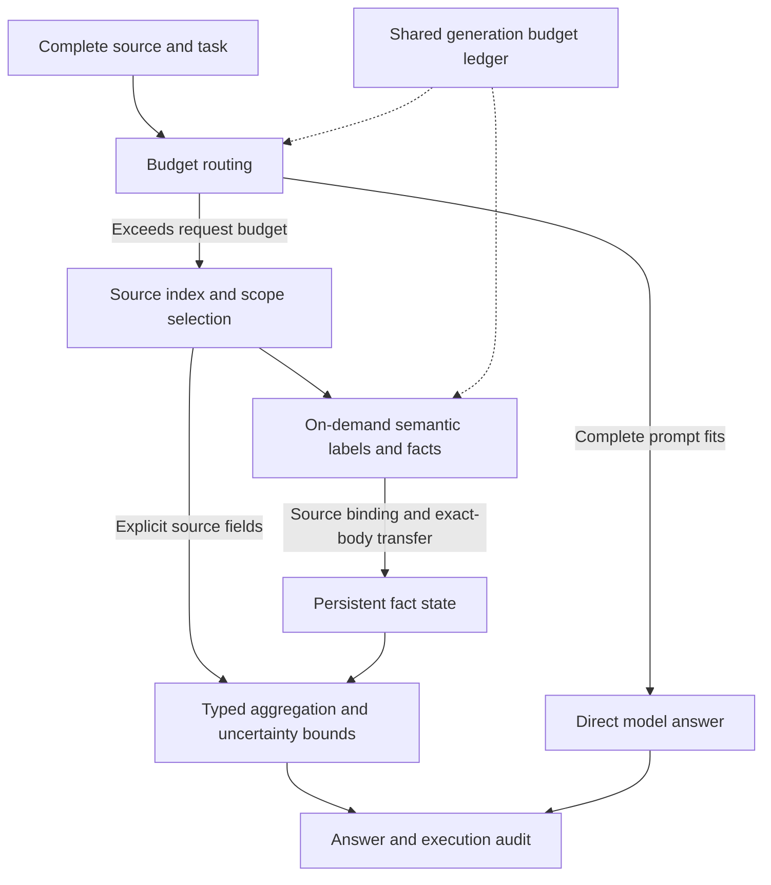

# Context Is All You Need

## Context Read and Understand Harness (CRU-Harness) · V3.2

**English** | [简体中文](README.zh-CN.md)

**Turn a bounded model window into an evidence workspace for million-token sources.**

**CRU-Harness** is an evidence computation system for sources that exceed a model's single-request capacity. V3.2 keeps and indexes the complete source outside the model, acquires semantic judgments within a bounded working window, accumulates source-bound facts, and executes statistics and conditional aggregation locally. It extends task execution beyond native input limits without changing model weights or adding training.

**The capacity breakthrough is in the execution system; the model's attention window remains unchanged.** The architectural shift is to make context an addressable, persistent, reusable, and computable software resource. Source size, the current inference window, and accumulated facts can then be managed independently.

[Technical implementation](docs/v32_implementation.md) · [Evaluation and per-sample results](docs/benchmark_v32.md) · [Results JSON](benchmarks/oolong_v32_20261101.json) · [Full project proposal](docs/CRU-Harness_Project_Proposal_V3.2.docx) · [Execution API](docs/harness_api.md)

## MM-NIAH visual reasoning token use · 2026-11-10

On the MM-NIAH development regression set, CRU-Harness v3.1 in forced-memory
mode used **97.20% fewer inference tokens** than the recorded original-image
Qwen direct baseline, with the same observed aggregate accuracy.
[Benchmark scope and sources](docs/mm_niah_token_use_20261110.md)

## Latest multimodal overflow evaluation · 2026-11-05

The optional page-memory modules add coverage retrieval for textless pages,
source-ID-bound count facts, bounded missing-page repair and plain-chat final
recovery. **On seven new visual QA questions: Direct 1/7, text memory 0/7,
old page Harness 3/7, new page Harness 4/7.** Each target PDF is outside the
previous 47-document corpus. These are small, derived evaluations.

The stronger count census requires every supplied page: related original images
alone exceed the service's **C = 262,144 tokens**, even after filename filtering.
An additional 502-page run contains one byte-identical page under another
filename. The disclosed **501-page post-hoc slice** has **514,026 original-image
tokens (1.96C)** and zero pixel overlap with the initial cohort:

| Method | Source-page exposure | Per-page count accuracy | Total-count relative error |
|---|---:|---:|---:|
| Original-resolution Direct | 49.50% | No valid count facts | No complete answer |
| Direct, all pages resized to 512px | 100% | 60.28% | 31.34% |
| **Page count memory v2.1, original resolution** | **100%** | **72.85%** | **5.05%** |

Both count fields must match per page. The new total is **903 versus 951**;
**no method gets the global total exactly right**. The 501-page slice reuses
fixed facts, with no extra model calls; it is not a new pre-registered generation
experiment. In the full 502-page run, count memory uses **32 calls / 545,324
tokens**, versus **1 / 142,406** for resized Direct. Ceilings are shared, actual
compute is not matched: C/request, 12C/task, 160 calls, 16,384 maximum output.

Sources: [MMLongBench-Doc](https://huggingface.co/datasets/yubo2333/MMLongBench-Doc)
and a derived [DocLayNet 1.0](https://github.com/DS4SD/DocLayNet) visual census.
These are **not official leaderboard scores**. Coverage is not object recall;
minimal sufficient crops have not been proved to exceed C. Frozen v2 exposes
2,023 pages at about 8C but fails complete fact extraction; v2.1 accuracy at 8C
has not been validated. The original defaults remain unchanged.

**32 unit checks and 51 local offline replays pass.** All predictions precede
scoring access. Total physical usage including development and judging is
**726 generations / 13,928,581 tokens**. Raw images, labels and request logs stay
local. Page v2.1 is distinct from core V3.2 and trajectory visual V3.

[English report](docs/visual_collective_20261105.md) ·
[中文报告](docs/visual_collective_20261105.zh-CN.md) ·
[Public results and duplicate correction](benchmarks/visual_collective_20261105.json) ·
[Opt-in API](docs/visual_page_memory.md)

```bash
python3 -S scripts/verify_visual_collective_results.py
python3 -S -m unittest tests.test_multimodal_page_harness tests.test_multimodal_page_harness_v2 tests.test_visual_count_memory_public
```

## All 451 LongMemEval-V2 Small questions · 2026-11-04

**The optional V3 visual controller scores 209/451 (46.34%), versus 72/451
(15.96%) for native-window head/tail Direct and 208/451 (46.12%) for visual V1.**
The full run replaces small-pilot scores as the current LongMemEval-V2 summary;
the dated experiments below remain separate records.

| Method | All 451 | Previously unused 375 | Screenshot questions 29 | Method-assigned inference tokens |
|---|---:|---:|---:|---:|
| Qwen Direct, original head/tail spans | 72/451 · 15.96% | 59/375 · 15.73% | 8/29 · 27.59% | 112,564,905 |
| Visual Harness V1 | 208/451 · 46.12% | 172/375 · 45.87% | 11/29 · 37.93% | 17,241,413 |
| **Visual handoff V3** | **209/451 · 46.34%** | **173/375 · 46.13%** | **12/29 · 41.38%** | **17,279,358** |

V3 improves on Direct by **30.38 percentage points**, with **84.65% fewer
method-assigned inference tokens**. Against V1 it gains four answers and loses
three, a net gain of only one. Flawed-premise questions remain weak: **28/128**
for either Harness versus **4/128** for Direct. The original default remains;
visual V3 is an explicit experimental option, distinct from the core V3.2 version.

The benchmark is the [official LongMemEval-V2](https://github.com/xiaowu0162/LongMemEval-V2/tree/2cc8c540bdb87fe6761629b585e727e1c4704520)
and [pinned dataset revision](https://huggingface.co/datasets/xiaowu0162/longmemeval-v2/tree/f152293e235517d504809563c833d7190b8c713b),
**Small tier, 100 historical trajectories per question**. The model is
`Qwen3.8-Flash-Next-FP8`. Direct has a 262,144-token request/task limit; Harness
has 16,384/request and 65,536/task, at most eight generations and 4,096 output
tokens. This is same-model, different-budget evaluation; Direct truncates the
source to original head/tail spans.

**1,353 method outcomes represent 931 independent execution jobs, not 1,353
independent model runs.** V1 and V3 have the identical no-query-image fallback;
422 text-path predictions and their judgments are explicitly shared. Actual
physical usage counts that path once: **2,093 inference generations / 130,747,706
tokens**, plus **256 judge generations / 330,210 tokens**. Method-assigned totals
in the table must not be summed as actual physical billing.

All predictions were fixed before scoring access. **931/931 physical request
trajectories replay offline**, and the public result verifier passes. Qwen
substitutes for the default LLM judge; deterministic questions retain upstream
matching rules. This is not an official leaderboard or LAFS score. Two histories
are reused; 76 questions were previously consumed and 375 were unused. Of 29
screenshot questions, 28 had already been used, so the full visual score is
primarily a regression result. Rule scores do not certify every extra claim in
an answer. Raw screenshots, labels and request logs remain local.

[English full report](docs/longmemeval_v2_full_20261104.md) ·
[中文完整审计及逐题结果](docs/longmemeval_v2_full_20261104.zh-CN.md) ·
[Results JSON](benchmarks/longmemeval_v2_full_20261104.json) ·
[All 1,353 rows](benchmarks/longmemeval_v2_full_20261104.csv) ·
[Visual V3 API and limits](docs/visual_evidence_handoff_v3.md) ·
[Earlier V3 development/holdout comparison](docs/longmemeval_v2_visual_handoff_20261104.md)

```bash
python3 -S scripts/verify_longmemeval_v2_full_results.py
python3 -S scripts/verify_longmemeval_v2_visual_handoff_results.py
```

## Million-token source results: core V3.2

These results come from the V3.2 local controlled OOLONG-synth experiment frozen on **2026-11-01**; this standalone release preserves that experiment record. The 12 sources have distinct context IDs and content hashes and were not used in this project's earlier tuning. Every source exceeds the **262,144-token** native limit reported by the evaluated Qwen service.

| Metric | Measured V3.2 result | Meaning |
|---|---:|---|
| Largest source | **1,866,427 Qwen tokens** | **7.12×** the service's native limit |
| Longest source receiving full credit | **1,792,309 Qwen tokens** | Official full credit at **6.84×** native length |
| Full-credit rate on above-native sources | **9/12 · 75.00%** | All 12 sources exceed the native limit |
| Mean official benchmark score | **81.25/100** | Includes partial credit on numerical questions; distinct from accuracy |
| Mean model usage per sample | **25,859 tokens** | Input plus output; **27.74% less** than adapted RLM on this cohort |

Maximum source length and longest full-credit source are reported separately: processing a source and answering correctly are different outcomes. These lengths measure the source space handled by the system, not text read by the model in one request.

### Benchmark provenance

We evaluate a source-disjoint subset of the existing public **OOLONG-synth** benchmark, introduced in [*Oolong: Evaluating Long Context Reasoning and Aggregation Capabilities*](https://arxiv.org/abs/2511.02817). Upstream sources are the [official repository](https://github.com/abertsch72/oolong) and [official Hugging Face dataset](https://huggingface.co/datasets/oolongbench/oolong-synth).

| Item | Frozen evaluation protocol |
|---|---|
| Dataset | `oolongbench/oolong-synth`, official `test` split |
| Data revision | `81d2f8d9349f6ff329d695f9be494051e9f05cb9` |
| Official scorer commit | `0bb7eabe839218fee7fe8d007f41cfc2fd3ae24c` |
| Evaluation unit | **12 distinct source contexts, one question per source** |
| Nominal length strata | 6 sources at 1,048,576 tokens and 6 at 2,097,152 tokens |
| Qwen-measured source length | **745,202–1,866,427 tokens**, measured on the complete raw source |
| Holdout exclusion | 56 previously used contexts excluded; **zero context-ID or full-source-hash overlap** |
| Seeds | **Selection: 20261105**; **model generation: 20261101** |

Nominal dataset lengths and Qwen-tokenized lengths are different measurements. Selection used metadata; questions and answers were not used for selection or current-version tuning. Context-level separation does not establish independence of underlying records or rule out model pretraining exposure. This is a locally frozen evaluation, not an official online leaderboard result.

The **official score** includes numerical partial credit (`0.75 ** abs(error)`); **full credit** means official score equals 1; **parsed exact match (EM)** means string equality after the official answer parser. CRU-Harness therefore reports **81.25/100 mean official score**, **9/12 full credit**, and **4/12 parsed EM** as separate metrics. The [public results JSON](benchmarks/oolong_v32_20261101.json) contains pinned data/scorer/baseline versions, key source-code SHA-256 values, per-context source hashes, and per-sample scores and usage; raw text and private request logs remain local.

### Same-model, same-budget comparison

All methods use `Qwen3.8-Flash-Next-FP8`, temperature=0, seed=20261101, and thinking disabled. Shared ceilings per sample and method are **16,384 input-plus-output tokens per request**, **65,536 cumulative tokens**, **32 physical generation requests**, and **2,048 output tokens per request**.

| Method | Full-credit samples / rate | Mean official score /100 | Mean input + output tokens |
|---|---:|---:|---:|
| **CRU-Harness V3.2 (`adaptive_v3`)** | **9/12 · 75.00%** | **81.25** | **25,859** |
| RLM official engine + environment adapter | 7/12 · 58.33% | 58.33 | 35,788 |
| MemGPT original controller + I/O adapter | 0/12 · 0.00% | 0.00 | 55,586 |

“Same budget” means shared resource ceilings; actual usage is measured separately. Budget exhaustion, unknown answers, and missing responses remain in the denominator. RLM has 5 budget failures; MemGPT has 7 budget failures and only 1 nonempty final answer. These are results for the stated adaptations and configuration. Adapter details, confidence intervals, complete controls, and per-sample results are in the [evaluation report](docs/benchmark_v32.md).

This is a 12-context pilot with one run per sample, not an official leaderboard submission or evidence of general or statistically significant superiority. Public-data pretraining contamination and overlap among underlying records have not been ruled out.

### Multimodal capability evaluation: LongMemEval-V2 visual subset · 2026-11-03

New **text + original-screenshot trajectory-memory evaluation**: develop on 12 consumed visual questions, freeze the candidate, then evaluate eight new visual questions. IDs/normalized text exclude the prior 60, with no exact query-image hash overlap. Two shared histories contain 200 trajectories and 5,095 history screenshots. These scores cover the **visual gotchas subset**, not overall LongMemEval-V2.

| Method | Correct/8 | UNKNOWN | Inference input + output tokens |
|---|---:|---:|---:|
| Head/tail Direct | 2/8 (25.0%) | 0 | 1,996,847 |
| Completion Harness baseline | 1/8 (12.5%) | 1 | 267,907 |
| Query image only, no history | 0/8 (0.0%) | 1 | 24,465 |
| Visual-recall Harness | 2/8 (25.0%) | 0 | 197,643 |

The candidate retains **1/1** baseline-correct questions, adds one, and uses **26.23% fewer inference tokens**. It matches Direct in total correct answers, with one exclusive correct answer on each side. **Absolute accuracy remains 25%, enterprise accuracy 0/4; the controller remains experimental and the original default stays unchanged.**

The implementation adds current-image state extraction, observed-field retrieval, before/action/after pairs and distinct-state retention when text repeats but images differ. Effect/destination constraints in version 2 regress from version 1 at 7/12 to 6/12 in development, so version 2 is not selected for holdout. Both records are retained without per-question oracle combination.

**56 regression checks, 104/104 offline replays and public verification pass.** All 32 holdout outcomes precede scoring-label access. Three Harness/query-image arms share 16k/request, 65k/task, eight-generation ceilings; Direct has a larger 262k window. Actual usage is separate. Qwen replaces default gpt-5.2 as judge. The small reused-history cohort does not establish general visual superiority, independently measured recall gains, official LAFS or leaderboard results.

[中文专项报告](docs/longmemeval_v2_visual_anchor_20261103.zh-CN.md) · [English report](docs/longmemeval_v2_visual_anchor_20261103.md) · [Results JSON](benchmarks/longmemeval_v2_visual_anchor_20261103.json) · [Opt-in API](docs/visual_anchor_memory.md)

### LongMemEval-V2 native completion and reversible display · 2026-11-03

Another **20 new questions** exclude the prior 40 question IDs and normalized text hashes, while reusing the same two histories. All **100 outcomes were fixed before scoring-label access**. This is a third question cohort; scores are not directly comparable across cohorts.

| Method | Correct/20 | UNKNOWN | Inference input + output tokens |
|---|---:|---:|---:|
| Native-window head/tail Direct | **4/20 · 20%** | 8 | 5,002,380 |
| Original trajectory Harness | **8/20 · 40%** | 1 | 650,438 |
| Native completion allocation | **11/20 · 55%** | 2 | 689,829 |
| Reversible evidence display | **11/20 · 55%** | 2 | 685,870 |

Both candidates retain **8/8** baseline-correct answers and add three correct answers: **+15 percentage points**. Unboxed finals decrease from six to three with completion and two with display. Reversible display saves **18,012 admission tokens (6.14%)** on matched complete prompts while preserving source-position unions and original images. End-to-end inference usage increases about **5–6%** over the original. Display matches completion accuracy; prompt savings are not an additional accuracy gain.

Full Direct is locally denied before generation on 20/20; its semantic accuracy is undefined. Harness ceilings match at 16,384/request, 65,536/task, eight generations and 4,096 maximum output; the original requests 1,024 and candidates allocate within admission. Direct has a larger budget. **258 checks and 100/100 offline replays pass; the original default remains, with explicit experimental opt-in.** Query-image accuracy remains 1/4; visual semantic recall and abstention calibration remain unresolved.

Two reused histories and one run per question limit generalization. Qwen replaces the official default gpt-5.2 judge; this is not official LAFS or a leaderboard score.

[中文完整报告与逐题结果](docs/longmemeval_v2_compact_holdout_20261103.zh-CN.md) · [English report](docs/longmemeval_v2_compact_holdout_20261103.md) · [Experimental API](docs/trajectory_completion_experiments.md) · [Results JSON](benchmarks/longmemeval_v2_compact_holdout_20261103.json)

### LongMemEval-V2 question holdout: retain the original route · 2026-11-03

A new **20-question holdout** has zero question-ID/text-hash overlap with the
first pilot, while reusing the same two source histories. All **120 outcomes
across six arms were fixed before any holdout scoring-label access**.

| Method | Correct /20 | UNKNOWN | Input + output tokens |
|---|---:|---:|---:|
| Original trajectory Harness | **13/20 · 65%** | 1 | 610,516 |
| Native-window head/tail Direct | 5/20 · 25% | 6 | 5,048,130 |
| Concise-answer head/tail Direct | 3/20 · 15% | 6 | 5,047,168 |
| Experimental all-question evidence gate | 5/20 · 25% | 13 | 1,084,553 |
| Experimental query-image visual route | 11/20 · 55% | 4 | 753,210 |

Full Direct was locally denied before generation on all 20 because of capacity;
its semantic accuracy is undefined. **Neither new candidate replaces the original
default.** The visual route corrects one old error but abstains on three old-correct
query-image questions. The strict gate rejects four gold-matching deterministic
candidates; model-reported confidence and rigid citation checks need calibration.

The implementation adds state/field retrieval, transition-linked original images,
source-bound claims, and local perceptual image matching. Numeric features for
5,099 images were rederived successfully in an isolated Pillow environment;
inference still uses original PNGs. These checks establish integrity, not improved
semantic recall. All **236 checks** and **120 offline controller replays** passed.
Original text/fact controllers remain unchanged. Native and Harness ceilings
differ; Qwen replaces the official default judge. This is a small local pilot,
not an official LAFS or leaderboard result.

Source: [LongMemEval-V2 official repository](https://github.com/xiaowu0162/LongMemEval-V2)
and [dataset](https://huggingface.co/datasets/xiaowu0162/longmemeval-v2).
[Protocol, failures and all per-question results](docs/longmemeval_v2_visual_holdout_20261103.md) ·
[中文报告](docs/longmemeval_v2_visual_holdout_20261103.zh-CN.md) ·
[Original 12-error analysis](docs/longmemeval_v2_visual_error_analysis_20261103.zh-CN.md)

```bash
python3 -S scripts/verify_longmemeval_v2_visual_results.py
```

### LongMemEval-V2 multimodal memory pilot · 2026-11-03

On a frozen **20-question small-tier pilot**, `Qwen3.8-Flash-Next-FP8` with the new
opt-in trajectory/image Harness scored **8/20 (40%)**, versus **1/20 (5%)** for
native-window head/tail Direct: **+35 percentage points**. Full Direct was
locally denied before generation on all 20 questions because complete text alone
exceeded 262,144 tokens; these are capacity denials, not semantic wrong answers.

The two shared histories contain 200 trajectories and 5,095 original screenshots.
Their canonical JSON text measures **31,476,162–34,235,595 Qwen tokens**, excluding
pixels. The longest correctly answered source is **34,235,595 tokens (130.60×
native capacity)**, accessed through a 16,384-token working ceiling. This is
external-source task capacity, not a larger attention window or a hard maximum.
Harness used **655,835 input + output tokens**, versus **5,049,555** for head/tail
Direct (**87.01% less**); compute ceilings differ.

Deterministically scored questions: **Harness 5/12, Direct 1/12**. LLM-judged
questions: **3/8 versus 0/8**, with Qwen replacing the official default judge.
Query-image questions: **1/4 versus 0/4**. Harness still answered 12 questions
incorrectly and returned no UNKNOWNs. This is not the full 451-question benchmark,
an official LAFS score, or general visual-memory superiority. The original text
and structured-fact controllers remain unchanged; **100 checks passed**.
All 60 outcomes, budgets, image bindings, and controller trajectories replayed
offline without new model calls.

Benchmark source: [official LongMemEval-V2 repository](https://github.com/xiaowu0162/LongMemEval-V2),
[paper](https://arxiv.org/abs/2605.12493), and
[dataset](https://huggingface.co/datasets/xiaowu0162/longmemeval-v2).
[Full protocol and per-question outcomes](docs/longmemeval_v2_qwen_20261103.md) ·
[中文报告](docs/longmemeval_v2_qwen_20261103.zh-CN.md) ·
[Results JSON](benchmarks/longmemeval_v2_qwen_20261103.json)

```bash
python3 -S scripts/verify_longmemeval_v2_results.py
```

### LongBench v2 extreme-context comparison · 2026-11-03

**All three tested models answered the largest tested natural source correctly:** its
complete Direct prompt admission count (including the resource notice and
16-token safety allowance) is **4,264,583 tokens**, or **4.06×** the
published 1,050,000-token native window and **260.29×** the Harness's 16,384-token
working ceiling. This is a tested lower bound on external-source task capacity,
not an increase in the model's attention window or a measured hard maximum.

| Exact model | Harness correct / all 12 | Harness correct / 8 above-native sources | Full Direct correct delivery / 4 native-admissible sources |
|---|---:|---:|---:|
| `gpt-6-sol` | **8/12 · 66.67%** | **6/8 · 75.00%** | 0/4 |
| `gpt-6-luna` | **6/12 · 50.00%** | **5/8 · 62.50%** | 0/4 |
| `gpt-6.1-terra` | **7/12 · 58.33%** | **5/8 · 62.50%** | 1/4 |

Full Direct retains the complete source and never truncates. Eight of twelve
sources exceed native admission; among the other four, two were rejected by
the provider for context length on every model, and Sol had one uncertain
delivery failure. Capacity and delivery failures are retained but are not
classified as semantic wrong answers. All 36 Harness tasks returned answers.

As a separate quality control on the **two longest sources**, balanced source
head/tail Direct inputs of approximately 786k and 746k tokens scored **Sol 2/2,
Luna 1/2, Terra 2/2**; Harness scored **2/2 on each model**. The two stronger
Direct controls therefore tie Harness here. These results establish source
capacity expansion, not general superiority over usable long-context inputs.

This is a length-selected, previously consumed **12-source regression cohort**,
not the full 503-question benchmark or a new blind holdout. The LongBench route
uses multiview evidence retrieval, voting and option verification; it is distinct
from the OOLONG V3.2 typed-fact aggregation route. Harness has a 65,536-token task
ceiling, whereas full Direct and the 800k head/tail control have larger single
requests: **compute budgets are unequal**. All outputs were fixed before labels
were opened. The report preserves the original incomplete trial, zero-generation
network recovery, errors, per-source choices, and separate strict-parser checks.
All 120 token/cost ledgers pass; one Harness outcome has an incomplete exception
record and is explicitly marked unavailable for full trajectory replay.

[Full report](docs/longbench_openai_limits_20261102.md) · [中文报告](docs/longbench_openai_limits_20261102.zh-CN.md) · [Public results](benchmarks/longbench_openai_limits_20261102.json)

```bash
python3 -S scripts/verify_longbench_openai_limits_results.py
```

### OpenAI transfer replay · 2026-11-02

The unchanged V3.2 algorithm was also run through the official Responses API on **the same 12 OOLONG-synth sources**, using the three exact models below. This tests transfer to another provider; it is a reused evaluation set, with one run per model/source and no current-version tuning against these outputs.

| Model | Full-credit samples / rate | Mean official score /100 | Mean input + output tokens | Execution errors |
|---|---:|---:|---:|---:|
| `gpt-6-sol` | **9/12 · 75.00%** | **75.00** | 25,471 | 0 |
| `gpt-6-luna` | **6/12 · 50.00%** | **50.00** | 19,400 | 3 |
| `gpt-6.1-terra` | **10/12 · 83.33%** | **83.33** | 25,441 | 0 |

All 36 outcomes are retained. Luna's three errors were received responses ending at the output limit, with known usage. All models used reasoning=none, a 16,384-token request ceiling and a 65,536-token task ceiling; temperature and seed were omitted. The 319 generations used **843,748 tokens** in total. The conservative generation-cost estimate is **$4.699397**, separate from the actual invoice.

Complete source-envelope counts were **651,081–1,582,486 OpenAI input tokens**. Six sources exceeded the published 1,050,000-token native window after full-direct prompt and output reservation: full-credit counts on that subgroup were **Sol 4/6, Luna 2/6, Terra 5/6**. These measurements differ from Qwen raw-text token counts. Direct was counted only; there was no direct-generation arm, so this experiment does not estimate causal gain over each base model. It provides transfer evidence for this task set, with clear output-protocol limitations on Luna.

[Full protocol and per-source results](docs/openai_transfer_20261102.md) · [中文报告](docs/openai_transfer_20261102.zh-CN.md) · [Public results JSON](benchmarks/openai_transfer_20261102.json)

Check the public metrics without credentials or network:

```bash
python3 -S scripts/verify_openai_transfer_results.py
```

### LongBench v2: full evaluation and long-context recovery

The earlier evidence-window Harness was also evaluated on **LongBench v2**, from the [official paper](https://arxiv.org/abs/2412.15204), [repository](https://github.com/THUDM/LongBench), and [503-question public dataset](https://huggingface.co/datasets/zai-org/LongBench-v2). Both paths use `Qwen3.8-Flash-Next-FP8`.

| Evaluation record | Direct Qwen correct / all | Harness correct / all | Harness with an answer |
|---|---:|---:|---:|
| Historical full 503-question run | 254/503 · 50.50% | **313/503 · 62.23%** | 502/503 |
| Latest dedicated 82-question long-context rerun | 1/82 · 1.22% | **50/82 · 60.98%** | 81/82 |

The full-run improvement is **11.73 percentage points**. In the 82-question record, Direct was rejected for context length on **79 questions**; Harness answered **49/79 correctly (62.03%)** on those same questions. This demonstrates recovery of useful task execution beyond the service's input capacity. Rejections are reported separately from wrong model answers; the comparison uses unequal inference compute and cached Direct results.

These are **historical local evaluations of the evidence-window path**, with repeated development on the public set. The 82-question selection mixes character estimates and cached usage, so it is not a tokenizer-verified above-native cohort. It is a separate rerun from the full 503, and neither record is a new V3.2 structured-fact evaluation or an official leaderboard submission. See the [full protocol, domain scores, and 82-case table](docs/benchmark_longbench_v2.md), [中文报告](docs/benchmark_longbench_v2.zh-CN.md), and [all per-sample results and source hashes](benchmarks/longbench_v2_historical.json).

Recompute the published result arithmetic locally, without model calls:

```bash
python scripts/verify_longbench_results.py
```

## Related work comparison

CRU-Harness combines external context management with task-specific evidence computation. The comparison below describes architectural emphasis; the measured three-way table above uses our pinned, same-model adaptations, rather than scores copied from papers with different models or budgets.

| Approach | Context organization | Aggregation | Provenance and uncertainty | Budget emphasis |
|---|---|---|---|---|
| **RAG (original formulation)** | Retrieve passages from an external index and condition generation on them | Model synthesis over retrieved evidence; programmable extensions are possible | Retrieved passages provide evidence; complete-source coverage and record bounds depend on the application | Retrieval size and generation context |
| **RLM** | External context accessed through a persistent REPL, with recursive model calls | Programmable code, reductions, and submodel calls | REPL state and execution trajectories can be inspected or logged; source tracking and bounds can be implemented in code | Recursive execution and configurable depth/call/token limits |
| **MemGPT (original architecture)** | Core, recall, and archival memory, managed through tools and memory paging | Multi-step retrieval, reading, and reasoning over documents | Retrieved documents support evidence-based answers; a typed record ledger is not its central abstraction | Bounded active context and memory management |
| **CRU-Harness V3.2** | Source index plus bounded model workspace and persistent source-bound facts | Typed local operators, exact-body semantic reuse, and deterministic ledger settlement | Record identity, spans, hashes, multiplicity, conflicts, unknowns, and group bounds are explicit | Shared request, cumulative-token, and physical-generation ceilings with replayable accounting |

Primary sources: RAG [paper](https://arxiv.org/abs/2005.11401) / [author-referenced Transformers implementation](https://github.com/huggingface/transformers/tree/main/src/transformers/models/rag); RLM [paper](https://arxiv.org/abs/2512.24601v3) / [code](https://github.com/alexzhang13/rlm); MemGPT [paper](https://arxiv.org/abs/2310.08560) / [historical official repository](https://github.com/letta-ai/letta).

The MemGPT experiment refers to the historical original controller pinned in the public JSON. RLM already supports programmable aggregation and persistent REPL execution; MemGPT already supports multi-step document retrieval and evidence use. CRU-Harness's contribution is the integration of **source-bound typed facts, exact-body reuse, deterministic aggregation, explicit unknown bounds, and shared-budget audit** into one execution contract. We do not claim exclusive ownership of external memory, retrieval, or code-based aggregation. See the [detailed related-work comparison](docs/related_work.md).

## Core technical advantages

### 1. Separate source space from model workspace

If the complete prompt fits, the system passes it directly to the model. Otherwise it uses a source index, explicit scopes, and local evidence windows. The model window supports the current inference step while the external system retains the complete source and execution state. Increasing source size no longer requires an equally large single request.

### 2. Combine semantic judgments with typed computation

A query plan separately represents scope, classification field, semantic condition, grouping key, and reduction. The model produces atomic labels; local operators perform counts, frequency comparisons, grouped statistics, date extrema, and numerical aggregation. `conditional_group` supports **label filtering → grouping by user → counting → argmax/argmin**, keeping semantic categories and user identities as separate dimensions.

### 3. Accumulate facts with source provenance

Mappings from short aliases to physical records, source spans, and raw hashes remain local. Validated classifications enter `FactLedger`. Resubmitting the same physical record does not count it twice; distinct physical instances retain their multiplicity. Conflicts and unknowns remain explicit. Structured answers are settled from the complete ledger rather than the amount of history that fits in the final prompt.

### 4. Reuse semantic work across identical complete bodies

For tasks whose labels depend only on the current body, the system classifies one representative of each identical projected body, then transfers the result to physical instances while preserving each instance's source, user, date, and multiplicity. **47,202 equivalent-fact transfers** were independently checked in the latest V3.2 run. In one case, **533 distinct bodies** covered **39,056 physical records**.

Reuse requires complete string equality, not approximate semantic merging. Direct model reading and derived coverage are recorded separately; whether representative classifications match ground-truth labels remains a separate validation question.

### 5. Bound uncertainty and repeated retrieval

Groups retain known matches, unknown counts, and lower and upper bounds. Early winner certification is allowed only when one candidate's lower bound strictly exceeds every competitor's upper bound; ties remain sets. Record-level and identical-body attempts share a cap, and repeated rounds without new facts stop, preventing duplicate copies from bypassing retry limits.

### 6. Share one budget and replay the audit

Classification, plan repair, recursion, summarization, and final answers share an input/output token and physical-generation ledger. Admission uses the service tokenizer and reserves output capacity before sending a request. Raw responses, source bindings, fact transfers, and final state can be replayed independently.

**All 12/12 V3.2 mechanism results passed inspection**, including 100 raw classification responses, 5,931 body bindings, and 52,839 retained source records. Across the experiment and its control, **24/24 Harness mechanism checks passed**, with zero discrepancies in official-score recomputation. **372 relevant checks passed before the latest experiment**; the command below covers **76 core checks in the current checkout**. These are different validation scopes.

## Architecture



| Module | Role |
|---|---|
| [`harness.py`](long_context_agent/harness.py) | Model-first routing and execution entry point |
| [`adaptive_evidence_v3.py`](long_context_agent/adaptive_evidence_v3.py) | Query planning, label acquisition, follow-up retrieval, stopping, and final settlement |
| [`fact_ledger.py`](long_context_agent/fact_ledger.py) | Source facts, conflicts, unknowns, aggregation, and group bounds |
| [`record_protocol.py`](long_context_agent/record_protocol.py) | Complete-body projection, short-alias protocol, and strict decoding |
| [`semantic_coverage.py`](long_context_agent/semantic_coverage.py) | Exact-body index and source-bound fact transfer |
| [`experiment_budget.py`](long_context_agent/experiment_budget.py) | Exact-tokenizer admission and shared resource accounting |
| [`independent_ingestion/`](independent_ingestion/) | Replaceable parsers and a common DocumentIR |
| [`reading_memory/`](reading_memory/) | Reading anchors, internal memory, and local state storage |

## Install and try

The project is released independently as CRU-Harness. Names such as `long_context_agent` remain the Python import package names.

Python 3.12 is recommended; the independent core supports Python 3.10+. Run from the repository root. The virtual-environment commands below are for macOS / Linux. The core offline demo uses only the Python standard library.

```bash
git clone https://github.com/quxiaoqiya/CRU-Harness.git
cd CRU-Harness
python3 -m venv .venv
source .venv/bin/activate
python examples/demo_harness.py
```

### Offline mechanism demo: no key or network

[`examples/demo_harness.py`](examples/demo_harness.py) uses **scripted model responses and simulated token counts**. It constructs 300 records with 2 distinct bodies, calls the actual V3.2 API, and checks source facts and deterministic aggregation. Typical output includes:

```text
mode: adaptive_fact_aggregation_v3
answer: Answer: 200
source_records: 300
unique_bodies: 2
directly_classified_records: 2
transferred_records: 298
known_records: 300
unknown_records: 0
final_fact_loss_count: 0
```

This demonstrates execution mechanics. It is **not a benchmark** and does not establish real-model accuracy or token savings.

### Connect a real model service

Online execution uses `LongContextHarness.answer_with_structured_facts(sample, client)`. `ProviderTransport` requires OpenAI-style Chat Completions and exact `/tokenize` measurement. For the official OpenAI Responses API, use the separate adapter below. Exact counting and complete usage are required for both paths.

Set `Q38_BASE_URL`, `Q38_MODEL`, and `Q38_API_KEY` in your local environment and prepare a UTF-8 file named `context.txt`:

```python
import os
from pathlib import Path

from long_context_agent import LongContextHarness
from long_context_agent.experiment_budget import (
    BudgetedClient, ExperimentBudget, ProviderTransport,
)

transport = ProviderTransport(
    base_url=os.environ["Q38_BASE_URL"],
    model=os.environ["Q38_MODEL"],
    api_key=os.environ["Q38_API_KEY"],
)
budget = ExperimentBudget(
    context_tokens=16_384, total_tokens=65_536,
    max_calls=32, max_output_tokens=2_048,
)
client = BudgetedClient(transport, budget)
harness = LongContextHarness(
    None, max_context_tokens=budget.context_tokens,
    reserve_tokens=budget.max_output_tokens,
)
result = harness.answer_with_structured_facts({
    "id": "local-example",
    "context": Path("context.txt").read_text(encoding="utf-8"),
    "question": "Answer the question from the source and provide the requested concise result.",
}, client)
print(result["answer"])
print(client.summary())
```

Replace the question with your task. Short inputs may use `direct_pass_v3`; record aggregation or fact-reading paths activate when the request budget is exceeded. The service must return complete `usage`. Model outputs and tool schemas also count toward the shared budget. Keep credentials, private sources, and runtime caches out of commits.

### OpenAI Responses adapter

With the same `budget`, `harness`, and input object, replace the transport and client with:

```python
from long_context_agent.openai_responses_transport import (
    OpenAIResponsesTransport, OpenAIResponsesBudgetedClient,
)

transport = OpenAIResponsesTransport(
    api_key=os.environ["OPENAI_API_KEY"],
    model="gpt-6-sol",
    reasoning_effort="none",
)
client = OpenAIResponsesBudgetedClient(transport, budget)
```

The adapter uses Responses input-token counting, disables automatic truncation and storage, requests the default service tier, and accounts for input plus output usage. It omits legacy sampling and chat-template fields, performs no implicit retries, and records incomplete responses explicitly. This is a text-only adapter; native hosted tools are not supported.

### Local document ingestion and core checks

```bash
python -m independent_ingestion.cli paper.md --json-out work/demo/document.ir.json

# Optional PDF text extraction
python -m pip install pypdf

# Core regression checks without model network calls
python -m pip install -r requirements-dev.txt
python -m pytest -q \
  tests/test_adaptive_evidence_v3.py \
  tests/test_semantic_coverage_v32.py \
  tests/test_record_protocol.py \
  tests/test_experiment_budget.py
```

The independent Harness offline demo requires only the standard library; development dependencies are listed in `requirements-dev.txt`. Scientific-document extraction, complex PDF/visual parsing, and database publication require separate acceptance testing and are not claimed as completed production pipelines here.

## Documentation and validation scope

- [V3.2 technical implementation](docs/v32_implementation.md)
- [Latest OOLONG evaluation and per-sample results](docs/benchmark_v32.md)
- [Machine-readable results JSON](benchmarks/oolong_v32_20261101.json)
- [OpenAI three-model transfer evaluation](docs/openai_transfer_20261102.md)
- [OpenAI transfer results JSON](benchmarks/openai_transfer_20261102.json)
- [LongBench v2 results and evaluation protocol](docs/benchmark_longbench_v2.md)
- [LongBench v2 per-sample results JSON](benchmarks/longbench_v2_historical.json)
- [Full project proposal](docs/CRU-Harness_Project_Proposal_V3.2.docx)
- [Execution API and budget rules](docs/harness_api.md)
- [DocumentIR contract](docs/document_ir_contract.md)
- [Model capability interface](docs/model_capability_gateway.md)
- [Internal memory and product projection boundaries](docs/product_projection_boundary.md)
- [Data usage notes](DATA_LICENSE.md)

Source provenance, computational consistency, and semantic correctness are validated separately. Valid spans establish that evidence comes from the input; deterministic aggregation establishes consistent ledger settlement; agreement between model classifications and ground truth remains an independent question. The current contribution is scalable, auditable execution, not unlimited accurate context or a guarantee that every long-context task can be solved within a fixed budget.

## Release scope and licensing

The repository contains the independent Harness, ingestion and memory interfaces, runnable examples, relevant tests, and the latest evaluation summary. Raw corpora, private deployment configuration, model-request logs, and runtime environments remain local.

No open-source license has currently been assigned to the project's original source code. Third-party code remains subject to its own licenses; the MIT notice for the bundled OOLONG scoring fixture is in [`third_party/oolong/LICENSE`](third_party/oolong/LICENSE). Redistribution of source datasets remains governed by their original terms.
