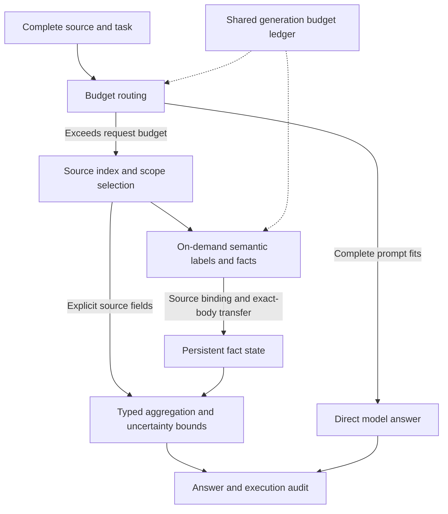

# Context Is All You Need

## Context Read and Understand Harness (CRU-Harness) · V3.2

**English** | [简体中文](README.zh-CN.md)

**Turn a bounded model window into an evidence workspace for million-token sources.**

**CRU-Harness** is an evidence computation system for sources that exceed a model's single-request capacity. V3.2 keeps and indexes the complete source outside the model, acquires semantic judgments within a bounded working window, accumulates source-bound facts, and executes statistics and conditional aggregation locally. It extends task execution beyond native input limits without changing model weights or adding training.

**The capacity breakthrough is in the execution system; the model's attention window remains unchanged.** The architectural shift is to make context an addressable, persistent, reusable, and computable software resource. Source size, the current inference window, and accumulated facts can then be managed independently.

[Technical implementation](docs/v32_implementation.md) · [Evaluation and per-sample results](docs/benchmark_v32.md) · [Results JSON](benchmarks/oolong_v32_20261101.json) · [Full project proposal](docs/CRU-Harness_Project_Proposal_V3.2.docx) · [Execution API](docs/harness_api.md)

## Results at a glance

These results come from the V3.2 local controlled OOLONG-synth experiment frozen on **2026-11-01**; this standalone release preserves that experiment record. The 12 sources have distinct context IDs and content hashes and were not used in this project's earlier tuning. Every source exceeds the **262,144-token** native limit reported by the evaluated Qwen service.

| Metric | Measured V3.2 result | Meaning |
|---|---:|---|
| Largest source | **1,866,427 Qwen tokens** | **7.12×** the service's native limit |
| Longest source receiving full credit | **1,792,309 Qwen tokens** | Official full credit at **6.84×** native length |
| Full-credit rate on above-native sources | **9/12 · 75.00%** | All 12 sources exceed the native limit |
| Mean official benchmark score | **81.25/100** | Includes partial credit on numerical questions; distinct from accuracy |
| Mean model usage per sample | **25,859 tokens** | Input plus output; **27.74% less** than adapted RLM on this cohort |

Maximum source length and longest full-credit source are reported separately: processing a source and answering correctly are different outcomes. These lengths measure the source space handled by the system, not text read by the model in one request.

### Benchmark provenance

We evaluate a source-disjoint subset of the existing public **OOLONG-synth** benchmark, introduced in [*Oolong: Evaluating Long Context Reasoning and Aggregation Capabilities*](https://arxiv.org/abs/2511.02817). Upstream sources are the [official repository](https://github.com/abertsch72/oolong) and [official Hugging Face dataset](https://huggingface.co/datasets/oolongbench/oolong-synth).

| Item | Frozen evaluation protocol |
|---|---|
| Dataset | `oolongbench/oolong-synth`, official `test` split |
| Data revision | `81d2f8d9349f6ff329d695f9be494051e9f05cb9` |
| Official scorer commit | `0bb7eabe839218fee7fe8d007f41cfc2fd3ae24c` |
| Evaluation unit | **12 distinct source contexts, one question per source** |
| Nominal length strata | 6 sources at 1,048,576 tokens and 6 at 2,097,152 tokens |
| Qwen-measured source length | **745,202–1,866,427 tokens**, measured on the complete raw source |
| Holdout exclusion | 56 previously used contexts excluded; **zero context-ID or full-source-hash overlap** |
| Seeds | **Selection: 20261105**; **model generation: 20261101** |

Nominal dataset lengths and Qwen-tokenized lengths are different measurements. Selection used metadata; questions and answers were not used for selection or current-version tuning. Context-level separation does not establish independence of underlying records or rule out model pretraining exposure. This is a locally frozen evaluation, not an official online leaderboard result.

The **official score** includes numerical partial credit (`0.75 ** abs(error)`); **full credit** means official score equals 1; **parsed exact match (EM)** means string equality after the official answer parser. CRU-Harness therefore reports **81.25/100 mean official score**, **9/12 full credit**, and **4/12 parsed EM** as separate metrics. The [public results JSON](benchmarks/oolong_v32_20261101.json) contains pinned data/scorer/baseline versions, key source-code SHA-256 values, per-context source hashes, and per-sample scores and usage; raw text and private request logs remain local.

### Same-model, same-budget comparison

All methods use `Qwen3.8-Flash-Next-FP8`, temperature=0, seed=20261101, and thinking disabled. Shared ceilings per sample and method are **16,384 input-plus-output tokens per request**, **65,536 cumulative tokens**, **32 physical generation requests**, and **2,048 output tokens per request**.

| Method | Full-credit samples / rate | Mean official score /100 | Mean input + output tokens |
|---|---:|---:|---:|
| **CRU-Harness V3.2 (`adaptive_v3`)** | **9/12 · 75.00%** | **81.25** | **25,859** |
| RLM official engine + environment adapter | 7/12 · 58.33% | 58.33 | 35,788 |
| MemGPT original controller + I/O adapter | 0/12 · 0.00% | 0.00 | 55,586 |

“Same budget” means shared resource ceilings; actual usage is measured separately. Budget exhaustion, unknown answers, and missing responses remain in the denominator. RLM has 5 budget failures; MemGPT has 7 budget failures and only 1 nonempty final answer. These are results for the stated adaptations and configuration. Adapter details, confidence intervals, complete controls, and per-sample results are in the [evaluation report](docs/benchmark_v32.md).

This is a 12-context pilot with one run per sample, not an official leaderboard submission or evidence of general or statistically significant superiority. Public-data pretraining contamination and overlap among underlying records have not been ruled out.

## Related work comparison

CRU-Harness combines external context management with task-specific evidence computation. The comparison below describes architectural emphasis; the measured three-way table above uses our pinned, same-model adaptations, rather than scores copied from papers with different models or budgets.

| Approach | Context organization | Aggregation | Provenance and uncertainty | Budget emphasis |
|---|---|---|---|---|
| **RAG (original formulation)** | Retrieve passages from an external index and condition generation on them | Model synthesis over retrieved evidence; programmable extensions are possible | Retrieved passages provide evidence; complete-source coverage and record bounds depend on the application | Retrieval size and generation context |
| **RLM** | External context accessed through a persistent REPL, with recursive model calls | Programmable code, reductions, and submodel calls | REPL state and execution trajectories can be inspected or logged; source tracking and bounds can be implemented in code | Recursive execution and configurable depth/call/token limits |
| **MemGPT (original architecture)** | Core, recall, and archival memory, managed through tools and memory paging | Multi-step retrieval, reading, and reasoning over documents | Retrieved documents support evidence-based answers; a typed record ledger is not its central abstraction | Bounded active context and memory management |
| **CRU-Harness V3.2** | Source index plus bounded model workspace and persistent source-bound facts | Typed local operators, exact-body semantic reuse, and deterministic ledger settlement | Record identity, spans, hashes, multiplicity, conflicts, unknowns, and group bounds are explicit | Shared request, cumulative-token, and physical-generation ceilings with replayable accounting |

Primary sources: RAG [paper](https://arxiv.org/abs/2005.11401) / [author-referenced Transformers implementation](https://github.com/huggingface/transformers/tree/main/src/transformers/models/rag); RLM [paper](https://arxiv.org/abs/2512.24601v3) / [code](https://github.com/alexzhang13/rlm); MemGPT [paper](https://arxiv.org/abs/2310.08560) / [historical official repository](https://github.com/letta-ai/letta).

The MemGPT experiment refers to the historical original controller pinned in the public JSON. RLM already supports programmable aggregation and persistent REPL execution; MemGPT already supports multi-step document retrieval and evidence use. CRU-Harness's contribution is the integration of **source-bound typed facts, exact-body reuse, deterministic aggregation, explicit unknown bounds, and shared-budget audit** into one execution contract. We do not claim exclusive ownership of external memory, retrieval, or code-based aggregation. See the [detailed related-work comparison](docs/related_work.md).

## Core technical advantages

### 1. Separate source space from model workspace

If the complete prompt fits, the system passes it directly to the model. Otherwise it uses a source index, explicit scopes, and local evidence windows. The model window supports the current inference step while the external system retains the complete source and execution state. Increasing source size no longer requires an equally large single request.

### 2. Combine semantic judgments with typed computation

A query plan separately represents scope, classification field, semantic condition, grouping key, and reduction. The model produces atomic labels; local operators perform counts, frequency comparisons, grouped statistics, date extrema, and numerical aggregation. `conditional_group` supports **label filtering → grouping by user → counting → argmax/argmin**, keeping semantic categories and user identities as separate dimensions.

### 3. Accumulate facts with source provenance

Mappings from short aliases to physical records, source spans, and raw hashes remain local. Validated classifications enter `FactLedger`. Resubmitting the same physical record does not count it twice; distinct physical instances retain their multiplicity. Conflicts and unknowns remain explicit. Structured answers are settled from the complete ledger rather than the amount of history that fits in the final prompt.

### 4. Reuse semantic work across identical complete bodies

For tasks whose labels depend only on the current body, the system classifies one representative of each identical projected body, then transfers the result to physical instances while preserving each instance's source, user, date, and multiplicity. **47,202 equivalent-fact transfers** were independently checked in the latest V3.2 run. In one case, **533 distinct bodies** covered **39,056 physical records**.

Reuse requires complete string equality, not approximate semantic merging. Direct model reading and derived coverage are recorded separately; whether representative classifications match ground-truth labels remains a separate validation question.

### 5. Bound uncertainty and repeated retrieval

Groups retain known matches, unknown counts, and lower and upper bounds. Early winner certification is allowed only when one candidate's lower bound strictly exceeds every competitor's upper bound; ties remain sets. Record-level and identical-body attempts share a cap, and repeated rounds without new facts stop, preventing duplicate copies from bypassing retry limits.

### 6. Share one budget and replay the audit

Classification, plan repair, recursion, summarization, and final answers share an input/output token and physical-generation ledger. Admission uses the service tokenizer and reserves output capacity before sending a request. Raw responses, source bindings, fact transfers, and final state can be replayed independently.

**All 12/12 V3.2 mechanism results passed inspection**, including 100 raw classification responses, 5,931 body bindings, and 52,839 retained source records. Across the experiment and its control, **24/24 Harness mechanism checks passed**, with zero discrepancies in official-score recomputation. **372 relevant checks passed before the latest experiment**; the command below covers **76 core checks in the current checkout**. These are different validation scopes.

## Architecture



| Module | Role |
|---|---|
| [`harness.py`](long_context_agent/harness.py) | Model-first routing and execution entry point |
| [`adaptive_evidence_v3.py`](long_context_agent/adaptive_evidence_v3.py) | Query planning, label acquisition, follow-up retrieval, stopping, and final settlement |
| [`fact_ledger.py`](long_context_agent/fact_ledger.py) | Source facts, conflicts, unknowns, aggregation, and group bounds |
| [`record_protocol.py`](long_context_agent/record_protocol.py) | Complete-body projection, short-alias protocol, and strict decoding |
| [`semantic_coverage.py`](long_context_agent/semantic_coverage.py) | Exact-body index and source-bound fact transfer |
| [`experiment_budget.py`](long_context_agent/experiment_budget.py) | Exact-tokenizer admission and shared resource accounting |
| [`independent_ingestion/`](independent_ingestion/) | Replaceable parsers and a common DocumentIR |
| [`reading_memory/`](reading_memory/) | Reading anchors, internal memory, and local state storage |

## Install and try

The project is released independently as CRU-Harness. Names such as `long_context_agent` remain the Python import package names.

Python 3.12 is recommended; the independent core supports Python 3.10+. Run from the repository root. The virtual-environment commands below are for macOS / Linux. The core offline demo uses only the Python standard library.

```bash
git clone https://github.com/quxiaoqiya/CRU-Harness.git
cd CRU-Harness
python3 -m venv .venv
source .venv/bin/activate
python examples/demo_harness.py
```

### Offline mechanism demo: no key or network

[`examples/demo_harness.py`](examples/demo_harness.py) uses **scripted model responses and simulated token counts**. It constructs 300 records with 2 distinct bodies, calls the actual V3.2 API, and checks source facts and deterministic aggregation. Typical output includes:

```text
mode: adaptive_fact_aggregation_v3
answer: Answer: 200
source_records: 300
unique_bodies: 2
directly_classified_records: 2
transferred_records: 298
known_records: 300
unknown_records: 0
final_fact_loss_count: 0
```

This demonstrates execution mechanics. It is **not a benchmark** and does not establish real-model accuracy or token savings.

### Connect a real model service

Online execution uses `LongContextHarness.answer_with_structured_facts(sample, client)`. The service must support both OpenAI-style Chat Completions and exact `/tokenize` measurement. A chat-only endpoint is insufficient for this strict-budget path.

Set `Q38_BASE_URL`, `Q38_MODEL`, and `Q38_API_KEY` in your local environment and prepare a UTF-8 file named `context.txt`:

```python
import os
from pathlib import Path

from long_context_agent import LongContextHarness
from long_context_agent.experiment_budget import (
    BudgetedClient, ExperimentBudget, ProviderTransport,
)

transport = ProviderTransport(
    base_url=os.environ["Q38_BASE_URL"],
    model=os.environ["Q38_MODEL"],
    api_key=os.environ["Q38_API_KEY"],
)
budget = ExperimentBudget(
    context_tokens=16_384, total_tokens=65_536,
    max_calls=32, max_output_tokens=2_048,
)
client = BudgetedClient(transport, budget)
harness = LongContextHarness(
    None, max_context_tokens=budget.context_tokens,
    reserve_tokens=budget.max_output_tokens,
)
result = harness.answer_with_structured_facts({
    "id": "local-example",
    "context": Path("context.txt").read_text(encoding="utf-8"),
    "question": "Answer the question from the source and provide the requested concise result.",
}, client)
print(result["answer"])
print(client.summary())
```

Replace the question with your task. Short inputs may use `direct_pass_v3`; record aggregation or fact-reading paths activate when the request budget is exceeded. The service must return complete `usage`. Model outputs and tool schemas also count toward the shared budget. Keep credentials, private sources, and runtime caches out of commits.

### Local document ingestion and core checks

```bash
python -m independent_ingestion.cli paper.md --json-out work/demo/document.ir.json

# Optional PDF text extraction
python -m pip install pypdf

# Core regression checks without model network calls
python -m pip install -r requirements-dev.txt
python -m pytest -q \
  tests/test_adaptive_evidence_v3.py \
  tests/test_semantic_coverage_v32.py \
  tests/test_record_protocol.py \
  tests/test_experiment_budget.py
```

The independent Harness offline demo requires only the standard library; development dependencies are listed in `requirements-dev.txt`. Scientific-document extraction, complex PDF/visual parsing, and database publication require separate acceptance testing and are not claimed as completed production pipelines here.

## Documentation and validation scope

- [V3.2 technical implementation](docs/v32_implementation.md)
- [Latest OOLONG evaluation and per-sample results](docs/benchmark_v32.md)
- [Machine-readable results JSON](benchmarks/oolong_v32_20261101.json)
- [Full project proposal](docs/CRU-Harness_Project_Proposal_V3.2.docx)
- [Execution API and budget rules](docs/harness_api.md)
- [DocumentIR contract](docs/document_ir_contract.md)
- [Model capability interface](docs/model_capability_gateway.md)
- [Internal memory and product projection boundaries](docs/product_projection_boundary.md)
- [Data usage notes](DATA_LICENSE.md)

Source provenance, computational consistency, and semantic correctness are validated separately. Valid spans establish that evidence comes from the input; deterministic aggregation establishes consistent ledger settlement; agreement between model classifications and ground truth remains an independent question. The current contribution is scalable, auditable execution, not unlimited accurate context or a guarantee that every long-context task can be solved within a fixed budget.

## Release scope and licensing

The repository contains the independent Harness, ingestion and memory interfaces, runnable examples, relevant tests, and the latest evaluation summary. Raw corpora, private deployment configuration, model-request logs, and runtime environments remain local.

No open-source license has currently been assigned to the project's original source code. Third-party code remains subject to its own licenses; the MIT notice for the bundled OOLONG scoring fixture is in [`third_party/oolong/LICENSE`](third_party/oolong/LICENSE). Redistribution of source datasets remains governed by their original terms.
