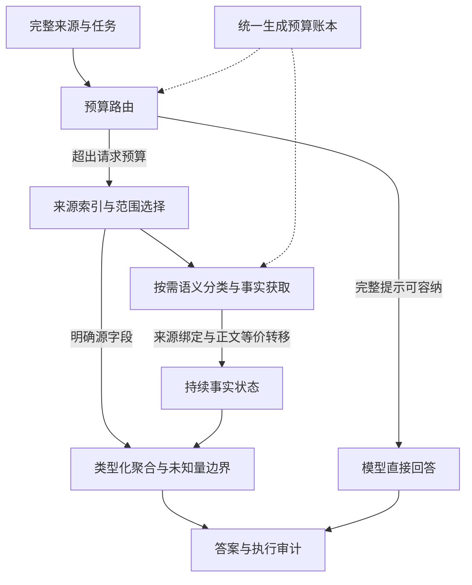

# uniparser-sdol · Long Context Harness V3.2

**让有限的模型窗口，承载百万级来源上的证据工作。**

V3.2 是面向超长材料的证据计算执行系统。完整来源由软件持有和索引，模型在有界工作窗口内完成必要的语义判断，来源事实持续累积，统计与条件聚合由本地程序执行。无需修改模型权重或增加训练，即可围绕超过单次输入容量的材料继续处理任务。

**容量突破发生在系统执行层，底座模型的单次注意力窗口保持不变。** 项目的革命性价值在于把上下文组织成可访问、可累积、可复用、可计算的软件资源，使材料规模、当前推断窗口与已取得的事实可以分别管理。

[技术实现](docs/v32_implementation.md) · [评测与逐题结果](docs/benchmark_v32.md) · [结果 JSON](benchmarks/oolong_v32_20261101.json) · [完整项目书](docs/uniparser_sdol_v32_project_proposal_20261102.docx) · [执行 API](docs/harness_api.md)

## 最新成果

以下为 2026-11-01 冻结实现后的 OOLONG-synth 本地受控实验。12 个来源具有不同的 context ID 和内容哈希，未参与本项目此前调优；实测长度全部超过本次 Qwen 服务报告的原生 **262,144 tokens** 上限。

| 指标 | V3.2 实测结果 | 含义 |
|---|---:|---|
| 最大来源规模 | **1,866,427 Qwen tokens** | 原生服务上限的 **7.12 倍** |
| 最长获满分来源 | **1,792,309 Qwen tokens** | 在原生长度的 **6.84 倍**来源上获官方满分 |
| 超原生来源满分率 | **9/12，75.00%** | 全部 12 个来源均超过原生服务上限 |
| Benchmark 官方均分 | **81.25/100** | 包含数值题的部分分，不等同于准确率 |
| 平均每题模型用量 | **25,859 tokens** | 包含输入与输出；较同批适配 RLM 少 **27.74%** |

最高来源长度与最长满分来源分别报告，避免把“材料进入执行流程”与“答案正确”混为一谈。这些数字衡量系统可处理的来源空间，不表示模型一次读取了全部正文。

### 同模型、同预算三路对比

模型为 `Qwen3.8-Flash-Next-FP8`，temperature=0、seed=20261101、关闭 thinking。每题每方法的共同上限为：单次输入加输出 **16,384 tokens**，累计 **65,536 tokens**，最多 **32 次物理生成**，每次最多 **2,048 输出 tokens**。

| 方法 | 满分题 / 满分率 | 官方均分 /100 | 平均输入＋输出 tokens |
|---|---:|---:|---:|
| **Harness V3.2** | **9/12 · 75.00%** | **81.25** | **25,859** |
| RLM 官方引擎＋环境适配 | 7/12 · 58.33% | 58.33 | 35,788 |
| MemGPT 原控制器＋I/O 适配 | 0/12 · 0.00% | 0.00 | 55,586 |

同预算指共同资源上限，实际消耗分别计量。所有预算耗尽、未知答案和无响应都保留在分母中。RLM 有 5 条预算失败；MemGPT 有 7 条预算失败，仅 1 条交付非空答案，因而不能把这一配置的结果外推为原论文方法的普遍能力。适配细节、置信区间、完整对照与逐题结果见[审计报告](docs/benchmark_v32.md)。

本轮是 12 个上下文、每题一次推理的先导实验，不是官方排行榜提交。公开数据的预训练污染和底层记录重叠未被排除，当前证据不支持宣称普遍或显著领先。

## 核心技术优势

### 1. 来源空间与模型工作空间解耦

完整提示可容纳时直接交给模型；超预算时使用来源索引、明确范围与局部证据。模型窗口承担当前推断，完整材料和执行状态由外部系统保留，来源增大不再自动要求单次请求同步增大。

### 2. 语义判断与类型化计算协作

查询计划分别表达范围、分类字段、语义条件、分组键和归约方式。模型产生原子标签，本地执行计数、频率比较、分组统计、日期极值与数值聚合。`conditional_group` 支持 **标签筛选 → 按用户分组 → 计数 → argmax/argmin**，避免把语义类别与用户身份混作同一维度。

### 3. 来源绑定的事实持续累积

短 alias 与真实记录、源文跨度、原始哈希的映射留在本地。通过校验的分类进入 `FactLedger`；同一物理记录重复提交不重复计数，不同物理实例保留各自重数；冲突和未知保持显式状态。结构化答案从完整账本结算，不依赖最后一次提示能装下多少历史窗口。

### 4. 完整正文等价复用

在标签仅由当前正文决定的任务中，完全相同的投影正文只分类一个代表，再按各物理实例的来源、用户、日期和真实重数回填。最新 V3.2 运行中，**47,202 条等价事实转移**得到独立核验；一个案例以 **533 种正文**覆盖 **39,056 条物理记录**。

复用要求完整字符串相等，不做模糊语义合并。模型真正阅读的范围与派生覆盖范围分别记录；代表分类与实际标注的一致性仍需验证。

### 5. 未知量边界与有限追检

各组保留已知匹配数、未知量及上下界。只有一个候选下界严格超过全部竞争者上界，才允许提前确定赢家；并列保留集合。每条记录与同文组共享尝试上限，连续无事实增益即停止，防止通过重复副本绕过限制。

### 6. 统一预算与可重放审计

分类、计划修复、递归、摘要和最终回答共享输入输出 token 与物理生成账本。发送前用服务端 tokenizer 计量并预留输出；原始返回、来源绑定、事实转移和最终状态可独立重放。

V3.2 的 **12/12 份机制结果通过检查**，100 次原始分类响应、5,931 个正文绑定与 52,839 条保留来源记录得到核验。整体实验包含对照的 **24/24 份 Harness 机制检查通过**，官方评分复算零差异。最新实验前的 **372 项相关检查通过**；当前 checkout 下方命令覆盖的 **76 项核心检查通过**，两者验收范围不同。

## 架构



| 模块 | 作用 |
|---|---|
| [`harness.py`](long_context_agent/harness.py) | 模型优先路由与执行入口 |
| [`adaptive_evidence_v3.py`](long_context_agent/adaptive_evidence_v3.py) | 查询计划、分类获取、追检、停止与最终结算 |
| [`fact_ledger.py`](long_context_agent/fact_ledger.py) | 来源事实、冲突/未知、聚合及分组边界 |
| [`record_protocol.py`](long_context_agent/record_protocol.py) | 完整正文投影、短 alias 协议和严格解码 |
| [`semantic_coverage.py`](long_context_agent/semantic_coverage.py) | 完整正文等价索引与来源绑定转移 |
| [`experiment_budget.py`](long_context_agent/experiment_budget.py) | 真实 tokenizer 准入与共同资源账本 |
| [`independent_ingestion/`](independent_ingestion/) | 可替换解析器与统一 DocumentIR |
| [`reading_memory/`](reading_memory/) | 阅读锚点、内部记忆和本地状态存储 |

## 安装与快速试用

推荐 Python 3.12，独立核心支持 Python 3.10+。在仓库根目录运行。以下虚拟环境命令适用于 macOS / Linux；核心离线演示仅使用 Python 标准库。

```bash
python3 -m venv .venv
source .venv/bin/activate
python examples/demo_harness.py
```

### 无密钥、无网络的机制演示

[`examples/demo_harness.py`](examples/demo_harness.py) 使用**模拟模型响应与模拟 token 计数**，构造 300 条、2 种重复正文，调用实际 V3.2 API 并检查来源事实和确定性聚合。典型输出包含：

```text
mode: adaptive_fact_aggregation_v3
answer: Answer: 200
source_records: 300
unique_bodies: 2
directly_classified_records: 2
transferred_records: 298
known_records: 300
unknown_records: 0
final_fact_loss_count: 0
```

这是执行机制演示，**不是 Benchmark**，不能证明真实模型的准确率或 token 节省。

### 接入真实模型服务

在线调用使用 `LongContextHarness.answer_with_structured_facts(sample, client)`。服务需要同时支持 OpenAI 风格的 Chat Completions 和精确 `/tokenize` 计量；只有普通聊天接口不足以执行这条严格预算路径。

先在本地环境中配置 `Q38_BASE_URL`、`Q38_MODEL`、`Q38_API_KEY`，再准备 UTF-8 文本 `context.txt`：

```python
import os
from pathlib import Path

from long_context_agent import LongContextHarness
from long_context_agent.experiment_budget import (
    BudgetedClient, ExperimentBudget, ProviderTransport,
)

transport = ProviderTransport(
    base_url=os.environ["Q38_BASE_URL"],
    model=os.environ["Q38_MODEL"],
    api_key=os.environ["Q38_API_KEY"],
)
budget = ExperimentBudget(
    context_tokens=16_384, total_tokens=65_536,
    max_calls=32, max_output_tokens=2_048,
)
client = BudgetedClient(transport, budget)
harness = LongContextHarness(
    None, max_context_tokens=budget.context_tokens,
    reserve_tokens=budget.max_output_tokens,
)
result = harness.answer_with_structured_facts({
    "id": "local-example",
    "context": Path("context.txt").read_text(encoding="utf-8"),
    "question": "根据来源回答问题，并给出所需的简洁结果。",
}, client)
print(result["answer"])
print(client.summary())
```

将问题替换为实际任务。短文本可能进入 `direct_pass_v3`；超过请求预算时才进入记录聚合或事实读取路径。服务端需返回完整 `usage`；模型输出和工具 schema 同样计入共同预算。请勿提交凭据、私人来源或运行缓存。

### 本地文档接入与核心检查

```bash
python -m independent_ingestion.cli paper.md --json-out work/demo/document.ir.json

# 可选：PDF 文本解析
python -m pip install pypdf

# 无模型网络调用的核心回归
python -m pip install -r requirements-dev.txt
python -m pytest -q \
  tests/test_adaptive_evidence_v3.py \
  tests/test_semantic_coverage_v32.py \
  tests/test_record_protocol.py \
  tests/test_experiment_budget.py
```

本仓库的独立 Harness 离线演示仅需标准库；开发测试依赖列在 `requirements-dev.txt`。真实科研文献抽取、复杂 PDF/视觉解析与数据库发布需独立验收；此处不宣称相关生产链已经完整交付。

## 文档与验证边界

- [V3.2 技术实现](docs/v32_implementation.md)
- [最新 OOLONG 评测与逐题结果](docs/benchmark_v32.md)
- [机器可读结果 JSON](benchmarks/oolong_v32_20261101.json)
- [完整项目书](docs/uniparser_sdol_v32_project_proposal_20261102.docx)
- [执行 API 与预算规则](docs/harness_api.md)
- [DocumentIR 合同](docs/document_ir_contract.md)
- [模型能力接口](docs/model_capability_gateway.md)
- [内部记忆与产品投影边界](docs/product_projection_boundary.md)
- [数据使用说明](DATA_LICENSE.md)

来源绑定、计算闭合与语义正确性分别验收：来源跨度有效证明材料来自输入，确定性聚合证明账本结算一致，模型分类与真实标注是否一致仍是独立问题。当前支持的是可扩展、可追溯的执行能力，不是无限准确上下文，也不代表所有超长任务都能在固定预算内解决。

## 发布范围与许可

仓库交付独立 Harness、输入解析与记忆接口、可运行示例、相关测试和最新评测摘要。原始语料、私人部署配置、模型请求日志和运行环境留在本地。

当前未为项目原创源码指定开源许可证；第三方代码遵循各自许可，随附 OOLONG 评分夹具的 MIT 通知见 [`third_party/oolong/LICENSE`](third_party/oolong/LICENSE)。公开原文数据的分发仍受其原始来源条款约束。
