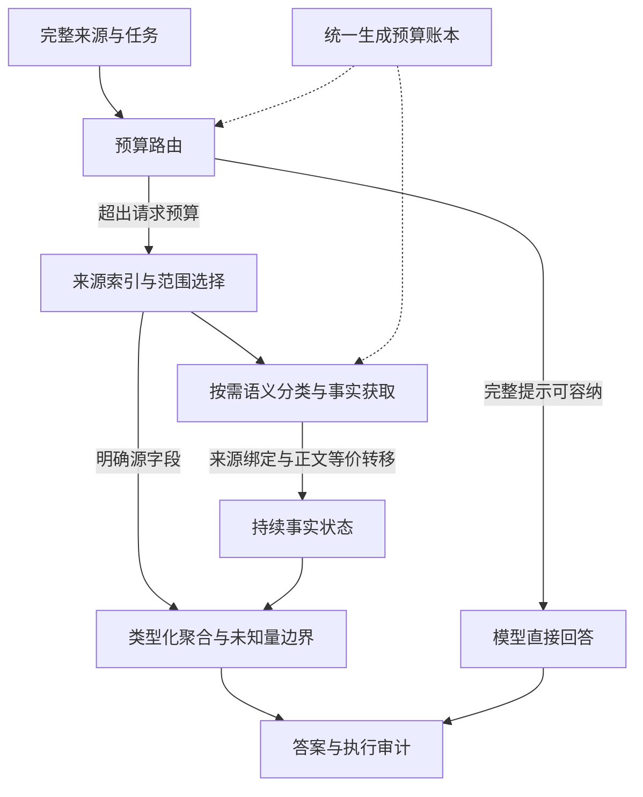

# Context Is All You Need

## Context Read and Understand Harness (CRU-Harness) · V3.2

[English](README.md) | **简体中文**

**让有限的模型窗口，承载百万级来源上的证据工作。**

**CRU-Harness** 是面向超长材料的证据计算执行系统。V3.2 由软件持有和索引完整来源，模型在有界工作窗口内完成必要的语义判断，来源事实持续累积，统计与条件聚合由本地程序执行。无需修改模型权重或增加训练，即可围绕超过单次输入容量的材料继续处理任务。

**容量突破发生在系统执行层，底座模型的单次注意力窗口保持不变。** 项目的革命性价值在于把上下文组织成可访问、可累积、可复用、可计算的软件资源，使材料规模、当前推断窗口与已取得的事实可以分别管理。

[技术实现](docs/v32_implementation.md) · [评测与逐题结果](docs/benchmark_v32.md) · [结果 JSON](benchmarks/oolong_v32_20261101.json) · [完整项目书](docs/CRU-Harness_Project_Proposal_V3.2.docx) · [执行 API](docs/harness_api.md)

## 最新评测：LongMemEval-V2 Small 全部 451 题 · 2026-11-04

**可选视觉 V3 控制器为 209/451（46.34%），原生窗口首尾直连为 72/451（15.96%），
旧视觉 V1 为 208/451（46.12%）。** 本轮全量结果作为当前 LongMemEval-V2 的主要结论；
下文不同日期的小样本实验分别保留，不合并分数。

| 方法 | 全部451题 | 此前未用375题 | 带截图29题 | 方法计量推理tokens |
|---|---:|---:|---:|---:|
| Qwen 直连，原文首尾截取 | 72/451 · 15.96% | 59/375 · 15.73% | 8/29 · 27.59% | 112,564,905 |
| 旧视觉 Harness V1 | 208/451 · 46.12% | 172/375 · 45.87% | 11/29 · 37.93% | 17,241,413 |
| **视觉证据交接 V3** | **209/451 · 46.34%** | **173/375 · 46.13%** | **12/29 · 41.38%** | **17,279,358** |

V3 较直连提升 **30.38 个百分点**，方法计量推理 tokens 减少 **84.65%**。相对旧 V1，
新增答对4题、损失3题，净增仅1题。错误前提识别仍是短板：两种 Harness 均为 **28/128**，
直连为 **4/128**。原默认路径保留；视觉 V3 为显式实验入口，与核心 V3.2 版本分开命名。

来源为 [LongMemEval-V2 官方代码](https://github.com/xiaowu0162/LongMemEval-V2/tree/2cc8c540bdb87fe6761629b585e727e1c4704520)
和[固定版本数据](https://huggingface.co/datasets/xiaowu0162/longmemeval-v2/tree/f152293e235517d504809563c833d7190b8c713b)，
使用 **Small 档，每题100条历史轨迹**。模型均为 `Qwen3.8-Flash-Next-FP8`。直连每次／累计上限
262,144 tokens；Harness 单次16,384、每题累计65,536、最多8次生成、最多4096输出。
这是同模型、不同预算配置的比较，直连仅保留原始来源首尾片段。

**1353条方法结果对应931个独立执行任务，并非1353次独立模型实验。** V1 与 V3 在无题图时
调用完全相同的文本流程，422条预测和相应裁判结果明确共享。实际物理用量只计一次：
**2093次推理、130,747,706 tokens**；裁判另计 **256次、330,210 tokens**。
表中方法计量不能相加当作实际物理计费。

全部推理固定后才打开评分标签；**931/931条独立执行轨迹离线重放通过**，公开结果校验通过。
LLM 题使用 Qwen 替代默认裁判，确定性题保留官方匹配规则。不是官方榜单或 LAFS 分数。
两份历史复用；76题此前已用，375题未用。29道视觉题中28题此前已用，因此视觉全量主要是回归评测。
规则得分不能证明回答中的所有附加解释均有依据。原图、参考答案和私人请求日志留在本地。

[中文完整审计与逐题结果](docs/longmemeval_v2_full_20261104.zh-CN.md) ·
[English full report](docs/longmemeval_v2_full_20261104.md) ·
[结果JSON](benchmarks/longmemeval_v2_full_20261104.json) ·
[1353条CSV](benchmarks/longmemeval_v2_full_20261104.csv) ·
[视觉V3接口与边界](docs/visual_evidence_handoff_v3.md) ·
[此前V3开发／新题对照](docs/longmemeval_v2_visual_handoff_20261104.zh-CN.md)

```bash
python3 -S scripts/verify_longmemeval_v2_full_results.py
python3 -S scripts/verify_longmemeval_v2_visual_handoff_results.py
```

## 百万级来源容量结果：核心 V3.2

以下数据来自 2026-11-01 冻结的 V3.2 OOLONG-synth 本地受控实验，本次独立发布沿用该实验记录。12 个来源具有不同的 context ID 和内容哈希，未参与本项目此前调优；实测长度全部超过本次 Qwen 服务报告的原生 **262,144 tokens** 上限。

| 指标 | V3.2 实测结果 | 含义 |
|---|---:|---|
| 最大来源规模 | **1,866,427 Qwen tokens** | 原生服务上限的 **7.12 倍** |
| 最长获满分来源 | **1,792,309 Qwen tokens** | 在原生长度的 **6.84 倍**来源上获官方满分 |
| 超原生来源满分率 | **9/12，75.00%** | 全部 12 个来源均超过原生服务上限 |
| Benchmark 官方均分 | **81.25/100** | 包含数值题的部分分，不等同于准确率 |
| 平均每题模型用量 | **25,859 tokens** | 包含输入与输出；较同批适配 RLM 少 **27.74%** |

最高来源长度与最长满分来源分别报告，避免把“材料进入执行流程”与“答案正确”混为一谈。这些数字衡量系统可处理的来源空间，不表示模型一次读取了全部正文。

### 基准来源与评测协议

本项目使用已有公开 **OOLONG-synth** 基准中来源不重叠的子集。基准由论文 [*Oolong: Evaluating Long Context Reasoning and Aggregation Capabilities*](https://arxiv.org/abs/2511.02817) 提出，上游来源为[官方代码仓库](https://github.com/abertsch72/oolong)和[官方 Hugging Face 数据集](https://huggingface.co/datasets/oolongbench/oolong-synth)。

| 项目 | 冻结评测协议 |
|---|---|
| 数据集 | `oolongbench/oolong-synth`，官方 `test` split |
| 数据 revision | `81d2f8d9349f6ff329d695f9be494051e9f05cb9` |
| 官方 scorer commit | `0bb7eabe839218fee7fe8d007f41cfc2fd3ae24c` |
| 评测单位 | **12 个不同来源上下文，每份来源只选一题** |
| 名义长度分层 | 1,048,576 tokens 层 6 份，2,097,152 tokens 层 6 份 |
| Qwen 实测来源长度 | **745,202–1,866,427 tokens**，对完整原始来源计量 |
| 留出排除 | 排除此前使用的 56 个上下文，**context ID 与全文哈希重叠均为零** |
| 随机种子 | **样本选择：20261105**；**模型生成：20261101** |

数据集名义长度与 Qwen tokenizer 实测长度是两种计量。选样仅用元数据，问题与答案未用于选样或当前版本调优。来源上下文不重叠不代表底层记录相互独立，也不能排除底座模型预训练接触。本轮为本地封存评测，不是官方线上排行榜成绩。

**官方分**包含数值题部分分（`0.75 ** abs(error)`）；**满分**指官方分等于 1；**解析后精确匹配（EM）**指经官方答案解析器处理后的字符串完全一致。因此 CRU-Harness 分别报告 **81.25/100 官方均分**、**9/12 满分**与 **4/12 解析后 EM**。[公开结果 JSON](benchmarks/oolong_v32_20261101.json) 包含固定的数据/scorer/基线版本、关键源码 SHA-256、各上下文来源哈希以及逐题评分与用量；原文与私人请求日志留在本地。

### 同模型、同预算三路对比

模型为 `Qwen3.8-Flash-Next-FP8`，temperature=0、seed=20261101、关闭 thinking。每题每方法的共同上限为：单次输入加输出 **16,384 tokens**，累计 **65,536 tokens**，最多 **32 次物理生成**，每次最多 **2,048 输出 tokens**。

| 方法 | 满分题 / 满分率 | 官方均分 /100 | 平均输入＋输出 tokens |
|---|---:|---:|---:|
| **CRU-Harness V3.2（`adaptive_v3`）** | **9/12 · 75.00%** | **81.25** | **25,859** |
| RLM 官方引擎＋环境适配 | 7/12 · 58.33% | 58.33 | 35,788 |
| MemGPT 原控制器＋I/O 适配 | 0/12 · 0.00% | 0.00 | 55,586 |

同预算指共同资源上限，实际消耗分别计量。所有预算耗尽、未知答案和无响应都保留在分母中。RLM 有 5 条预算失败；MemGPT 有 7 条预算失败，仅 1 条交付非空答案，因而不能把这一配置的结果外推为原论文方法的普遍能力。适配细节、置信区间、完整对照与逐题结果见[审计报告](docs/benchmark_v32.md)。

本轮是 12 个上下文、每题一次推理的先导实验，不是官方排行榜提交。公开数据的预训练污染和底层记录重叠未被排除，当前证据不支持宣称普遍或显著领先。

### 多模态能力评测：LongMemEval-V2 视觉题专项 · 2026-11-03

新增 **文本＋原始截图的轨迹记忆评测**：先用 12 道已使用视觉题开发，再固定候选，测试 8 道新视觉题；与此前 60 题的 ID／规范化正文哈希零重叠，题图字节哈希也不重复。仍复用两份历史，共 200 轨迹、5095 张历史截图。以下是 **视觉 gotchas 子集**，不是整体 LongMemEval-V2 分数。

| 路径 | 答对／8 | UNKNOWN | 推理输入＋输出 tokens |
|---|---:|---:|---:|
| 直连首尾截断 | 2/8 (25.0%) | 0 | 1,996,847 |
| 原完成预算版 Harness | 1/8 (12.5%) | 1 | 267,907 |
| 只看题图，无历史记忆 | 0/8 (0.0%) | 1 | 24,465 |
| 新视觉召回 Harness | 2/8 (25.0%) | 0 | 197,643 |

新候选保留原完成版答对的 **1/1**，新增 1 题，推理 tokens 减少 **26.23%**。正确题数与首尾直连相同，但双方各有一题只被自己答对；不代表逐题等效。**绝对准确率仍只有 25%，企业域 0/4，保留实验入口，原默认路径不变。**

实现包含题图可见状态提取、观察字段检索、操作前后状态配对，以及相同文字／不同图片的状态保留。第二版新增控件效果与目标限定条件，但开发集由第一版 7/12 降至 6/12，未选作新题候选。两版完整记录均公开，不逐题择优拼接。

**56 项回归、104/104 条离线重放及公开核验通过。** 新题 32 条输出全部在本轮评分标签访问前固定。三个 Harness／题图路径共享单次 16k、累计 65k、8 次生成的上限，直连使用更大的 262k 窗口；实际用量单列。Qwen 代替官方默认 gpt-5.2 作为裁判，小样本且历史来源复用，不能宣称普遍视觉优势、独立视觉召回率提升、官方 LAFS 或线上榜单成绩。

[中文专项报告](docs/longmemeval_v2_visual_anchor_20261103.zh-CN.md) · [English report](docs/longmemeval_v2_visual_anchor_20261103.md) · [Results JSON](benchmarks/longmemeval_v2_visual_anchor_20261103.json) · [Opt-in API](docs/visual_anchor_memory.md)

### LongMemEval-V2 原生完成预算与可逆展示 · 2026-11-03

再换一批 **20 道新问题**，与此前 40 题的 ID／规范化正文哈希零重叠，仍复用同两份历史。五路 **100 条结果全部固定后才打开本轮评分标签**。这是第三批问题留出，不能直接与上一批分数比较。

| 路径 | 答对／20 | UNKNOWN | 推理输入＋输出 tokens |
|---|---:|---:|---:|
| 原生窗口首尾直连 | **4/20 · 20%** | 8 | 5,002,380 |
| 原轨迹 Harness | **8/20 · 40%** | 1 | 650,438 |
| 原生完成预算版 | **11/20 · 55%** | 2 | 689,829 |
| 可逆证据展示版 | **11/20 · 55%** | 2 | 685,870 |

两种新版均保留原版答对的 **8/8**，各新增 3 道正确题，提升 **15 个百分点**。最终未完整 boxed 的输出由 6 条降到完成版 3 条／展示版 2 条。可逆展示的匹配完整提示准入计数减少 **18,012 tokens（6.14%）**，保留来源位置区间与原图；新版最终推理总用量较原版增加约 **5–6%**。展示版与完成版总分相同，不能把提示空间节省称为额外准确率提升。

完整直连 20/20 因容量不足在生成前被本地拒绝，语义准确率不适用。各 Harness 硬上限均为单次 16,384／累计 65,536／8 次生成／最多 4096 输出，旧版实际请求 1024，新版按准入条件分配；直连预算更大。**258 项检查及 100/100 离线重放通过，原默认路径保持不变，新增控制器显式启用。** 视觉子集仍只有 1/4 正确；没有验证视觉语义召回或拒答校准已经解决。

仍为两份共享历史、单次小样本试评，LLM 裁判以 Qwen 替代官方默认 gpt-5.2；不是官方 LAFS 或线上榜单分数。

[中文完整报告与逐题结果](docs/longmemeval_v2_compact_holdout_20261103.zh-CN.md) · [English report](docs/longmemeval_v2_compact_holdout_20261103.md) · [Experimental API](docs/trajectory_completion_experiments.md) · [Results JSON](benchmarks/longmemeval_v2_compact_holdout_20261103.json)

### LongMemEval-V2 问题留出对照：保留原路径 · 2026-11-03

另一批 **20 道问题留出样本**与首轮题目 ID／正文哈希零重叠，仍复用同两份历史。
六路共 **120 条输出全部在任何留出评分标签访问前固定**。

| 路径 | 答对／20 | UNKNOWN | 输入＋输出 tokens |
|---|---:|---:|---:|
| 原轨迹 Harness | **13/20，65%** | 1 | 610,516 |
| 原生窗口首尾直连 | 5/20，25% | 6 | 5,048,130 |
| 简短输出首尾直连 | 3/20，15% | 6 | 5,047,168 |
| 全题证据门控实验 | 5/20，25% | 13 | 1,084,553 |
| 按题图启用视觉检索的实验路由 | 11/20，55% | 4 | 753,210 |

完整直连 20 题均在生成前因容量不足被本地拒绝，语义准确率不适用。
**两项新方案均未替换原默认路径。** 视觉路由修复旧版一道错题，却拒答了旧版答对的三道带题图问题；
严格门控还拒绝了四个与标准答案匹配的确定性题候选。模型自报置信度及刚性引用校验需要校准，
不能以覆盖率下降包装准确率提升。

新增状态／字段检索、操作前后原图、来源约束及本地图像感知匹配。5,099 张图的数值特征在
隔离的 Pillow 环境重新计算并核对通过，推理仍用原始 PNG；这些机械检查不证明语义召回提升。
**236 项检查、120 条控制流程离线重放通过**，原文本／事实控制器未改。
原生与 Harness 预算不相等，裁判由官方默认模型换为 Qwen；本轮是本地小样本试评，
不是官方 LAFS 或排行榜成绩。

基准来自 [LongMemEval-V2 官方仓库](https://github.com/xiaowu0162/LongMemEval-V2)及
[官方数据集](https://huggingface.co/datasets/xiaowu0162/longmemeval-v2)。
[完整协议、失败分析与逐题结果](docs/longmemeval_v2_visual_holdout_20261103.zh-CN.md) ·
[English report](docs/longmemeval_v2_visual_holdout_20261103.md) ·
[首轮 12 道错题分析](docs/longmemeval_v2_visual_error_analysis_20261103.zh-CN.md)

```bash
python3 -S scripts/verify_longmemeval_v2_visual_results.py
```

### LongMemEval-V2 多模态记忆试评 · 2026-11-03

固定 **20 题 small 层级试评**中，`Qwen3.8-Flash-Next-FP8` 配合新增的轨迹／图片
适配 Harness，答对 **8/20（40%）**；原生窗口内首尾直连答对 **1/20（5%）**，
提高 **35 个百分点**。完整直连的 20 题均因完整文本已超出 262,144 tokens，
在生成前被本地准入拒绝；容量拒绝不归类为语义答错。

两个共享历史共含 200 条轨迹、5,095 张原始截图，规范化 JSON 文本经 Qwen 计数为
**31,476,162–34,235,595 tokens**，不含截图像素。最长答对来源为
**34,235,595 tokens，约原生容量的 130.60 倍**，通过 16,384-token 工作窗口检索读取。
这是外部来源任务容量，不表示扩大模型注意力窗口，也尚未找到硬极限。
Harness 输入＋输出总用量 **655,835 tokens**，首尾直连 **5,049,555 tokens**，
减少 **87.01%**；两路计算预算不同。

确定性评分题分别答对 **5/12、1/12**，裁判题分别 **3/8、0/8**，裁判由官方默认模型
替换为 Qwen。带题图样本分别为 **1/4、0/4**。Harness 仍有 12 题答错，且没有 UNKNOWN；
本轮不是完整 451 题、官方 LAFS 分数或普遍视觉记忆优势的证明。原文本／结构化事实
控制器未修改，**100 项检查通过**；60 条记录的预算、图片绑定和控制轨迹全部离线重放通过。

基准来自 [LongMemEval-V2 官方仓库](https://github.com/xiaowu0162/LongMemEval-V2)、
[论文](https://arxiv.org/abs/2605.12493)及
[官方数据集](https://huggingface.co/datasets/xiaowu0162/longmemeval-v2)。
[完整协议与逐题结果](docs/longmemeval_v2_qwen_20261103.zh-CN.md) ·
[English report](docs/longmemeval_v2_qwen_20261103.md) ·
[结果 JSON](benchmarks/longmemeval_v2_qwen_20261103.json)

```bash
python3 -S scripts/verify_longmemeval_v2_results.py
```

### LongBench v2 极限上下文对照 · 2026-11-03

**三个模型都答对了本轮最长的自然来源样本**：其完整 Direct 提示准入计数（含资源说明与 16-token 安全余量）为
**4,264,583 tokens**，达到公开 **1,050,000-token 原生窗口的 4.06 倍**、
Harness **16,384-token 工作窗口上限的 260.29 倍**。这是外部来源任务容量的
已测下界；模型的注意力窗口没有改变，也尚未找到 Harness 的硬极限。

| 精确模型 | Harness 全 12 题答对 | Harness 超原生 8 题答对 | 完整直连原生可准入 4 题正确交付 |
|---|---:|---:|---:|
| `gpt-6-sol` | **8/12 · 66.67%** | **6/8 · 75.00%** | 0/4 |
| `gpt-6-luna` | **6/12 · 50.00%** | **5/8 · 62.50%** | 0/4 |
| `gpt-6.1-terra` | **7/12 · 58.33%** | **5/8 · 62.50%** | 1/4 |

完整直连保留全部原文且不截断。12 个来源中有 8 个超过原生准入；其余 4 个中，
每个模型都有 2 个被服务端以超上下文拒绝，Sol 另有 1 个交付状态不明的失败。
容量和交付失败保留在统计中，但不归类为语义答错。Harness 的 36 项任务全部返回答案。

另对**最长两题**补跑了首尾截取直连质量对照，输入约 786k、746k tokens：
**Sol 2/2、Luna 1/2、Terra 2/2**；Harness 三个模型均为 **2/2**。
Sol、Terra 的可用长输入直连与 Harness 持平。本轮证明了来源容量扩展，
尚不能证明对可用长输入的普遍准确率优势。

这是按长度选择、此前已使用过的 **12 来源回归集**，并非完整 503 题或新盲测。
LongBench 路径采用多视图证据检索、投票和选项验证，与 OOLONG V3.2 的类型化事实
聚合路径不同。Harness 累计预算为 65,536 tokens，完整直连与 800k 首尾对照可使用
更大的单次请求，**计算预算不相等**。所有输出在首次打开标准答案前固定。
完整报告保留原始不完整试验、仅零生成任务的网络恢复、错误、逐题选项和严格解析核对。
全部 120 份 token／费用账本核对通过；1 条 Harness 结果缺少异常记录，
明确标为无法完整重放轨迹。

[完整中文报告](docs/longbench_openai_limits_20261102.zh-CN.md) · [English report](docs/longbench_openai_limits_20261102.md) · [公开结果 JSON](benchmarks/longbench_openai_limits_20261102.json)

```bash
python3 -S scripts/verify_longbench_openai_limits_results.py
```

### OpenAI 三模型迁移重放 · 2026-11-02

保持 V3.2 算法不变，通过官方 Responses API，在**同一组 12 个 OOLONG-synth 来源**上运行以下三个精确模型。这检验了向另一提供方迁移的表现；来源是已用评测集，每模型每来源仅运行一次，本轮不依据新输出调优。

| 模型 | 满分题数／满分率 | 官方均分／100 | 平均输入＋输出 tokens | 执行错误 |
|---|---:|---:|---:|---:|
| `gpt-6-sol` | **9/12 · 75.00%** | **75.00** | 25,471 | 0 |
| `gpt-6-luna` | **6/12 · 50.00%** | **50.00** | 19,400 | 3 |
| `gpt-6.1-terra` | **10/12 · 83.33%** | **83.33** | 25,441 | 0 |

全部 36 项结果保留在分母中。Luna 的三项错误均为触及输出上限的已接收响应，usage 已知。三路统一使用 reasoning=none、单次 16,384 和每题累计 65,536 token 上限，不发送 temperature 或 seed。319 次生成共使用 **843,748 tokens**，保守生成费用估算为 **$4.699397**，不是实际账单。

完整来源输入封装计数为 **651,081–1,582,486 OpenAI input tokens**。计入完整 direct 提示和输出预留后，6 个来源超过公开的 1,050,000-token 原生窗口；该子组满分题数为 **Sol 4/6、Luna 2/6、Terra 5/6**。这种计量不同于 Qwen 原文 token 数。本轮 direct 只计数、没有生成比较臂，因此不能估计对底座的因果增益。结果支持这组任务上的迁移，同时暴露了 Luna 的输出协议兼容性限制。

[完整协议与逐题结果](docs/openai_transfer_20261102.zh-CN.md) · [English](docs/openai_transfer_20261102.md) · [公开结果 JSON](benchmarks/openai_transfer_20261102.json)

无需凭证或网络即可核对公开指标：

```bash
python3 -S scripts/verify_openai_transfer_results.py
```

### LongBench v2：全量成绩与超长上下文恢复

早期证据窗口版 Harness 还在 **LongBench v2** 上完成了评测，来源为[官方论文](https://arxiv.org/abs/2412.15204)、[官方仓库](https://github.com/THUDM/LongBench)和 [503 题公开数据集](https://huggingface.co/datasets/zai-org/LongBench-v2)。两条路径均使用 `Qwen3.8-Flash-Next-FP8`。

| 实验记录 | Direct Qwen 正确 / 全部 | Harness 正确 / 全部 | Harness 有答案 |
|---|---:|---:|---:|
| 历史 503 题全量运行 | 254/503 · 50.50% | **313/503 · 62.23%** | 502/503 |
| 最后统一重跑的 82 题超长子集 | 1/82 · 1.22% | **50/82 · 60.98%** | 81/82 |

全量结果提升 **11.73 个百分点**。在 82 题记录中，Direct 有 **79 题因上下文长度被服务拒绝**，Harness 在这些相同题目上答对 **49/79（62.03%）**，体现了超出服务输入容量后恢复有效解题路径的价值。容量拒绝与模型答错分别记录；两条路径的推理计算量不同，Direct 使用已有缓存。

这些是**历史证据窗口路径的本地评测**，公开样本已经过多轮开发使用。82 题筛选混合字符估算和缓存 usage，不代表全部经过 tokenizer 实测超出原生上限；它与 503 全量属于不同运行阶段。两份成绩均不是当前 V3.2 结构化事实版本的新重跑，也不是官方排行榜提交。详见[完整中文报告、领域成绩和 82 题逐题表](docs/benchmark_longbench_v2.zh-CN.md)、[English report](docs/benchmark_longbench_v2.md)及[全部逐题结果与来源哈希](benchmarks/longbench_v2_historical.json)。

无需模型调用，即可在本地复算发布结果：

```bash
python scripts/verify_longbench_results.py
```

## 相似工作对比

CRU-Harness 把外部上下文管理与面向任务的证据计算结合起来。下表比较架构取向；上方实测三路表使用固定版本、同模型的本地适配配置，不混排论文中异模型、异预算的分数。

| 方法 | 上下文组织 | 聚合方式 | 来源与不确定性 | 预算取向 |
|---|---|---|---|---|
| **RAG（原始论文）** | 从外部索引检索片段，为生成提供条件 | 模型综合检索证据，也可扩展程序算子 | 检索片段提供证据，全文覆盖与记录边界取决于应用实现 | 检索规模与生成窗口 |
| **RLM** | 通过持久 REPL 访问外部上下文，递归调用模型 | 可编程代码、归约与子模型调用 | 可检查或记录 REPL 状态与执行轨迹，也可编程实现来源追踪和边界 | 递归执行及可配置的深度、调用和 token 限制 |
| **MemGPT（原始架构）** | 通过工具与记忆换页管理 core、recall、archive 记忆 | 对文档进行多步检索、阅读与推理 | 检索文档支持基于证据的回答，类型化记录账本不是其核心抽象 | 有限活动上下文与记忆管理 |
| **CRU-Harness V3.2** | 来源索引、有界模型工作空间与持续来源事实 | 类型化本地算子、完整正文等价复用、确定性账本结算 | 显式记录身份、跨度、哈希、重数、冲突、未知与分组边界 | 单次请求、累计 token 与物理生成共享上限，并可重放计量 |

一手来源：RAG [论文](https://arxiv.org/abs/2005.11401) / [作者指向的 Transformers 实现](https://github.com/huggingface/transformers/tree/main/src/transformers/models/rag)；RLM [论文](https://arxiv.org/abs/2512.24601v3) / [代码](https://github.com/alexzhang13/rlm)；MemGPT [论文](https://arxiv.org/abs/2310.08560) / [历史官方仓库](https://github.com/letta-ai/letta)。

本轮 MemGPT 实验指公开 JSON 中固定的历史原控制器。RLM 已支持可编程聚合和持久 REPL 执行，MemGPT 已支持多步文档检索与证据使用。CRU-Harness 的贡献在于把**来源绑定的类型化事实、完整正文复用、确定性聚合、显式未知边界与共享预算审计**整合为同一执行合同；不宣称外部记忆、检索或代码聚合为本项目独有。详见[相似工作完整对比](docs/related_work.md)。

## 核心技术优势

### 1. 来源空间与模型工作空间解耦

完整提示可容纳时直接交给模型；超预算时使用来源索引、明确范围与局部证据。模型窗口承担当前推断，完整材料和执行状态由外部系统保留，来源增大不再自动要求单次请求同步增大。

### 2. 语义判断与类型化计算协作

查询计划分别表达范围、分类字段、语义条件、分组键和归约方式。模型产生原子标签，本地执行计数、频率比较、分组统计、日期极值与数值聚合。`conditional_group` 支持 **标签筛选 → 按用户分组 → 计数 → argmax/argmin**，避免把语义类别与用户身份混作同一维度。

### 3. 来源绑定的事实持续累积

短 alias 与真实记录、源文跨度、原始哈希的映射留在本地。通过校验的分类进入 `FactLedger`；同一物理记录重复提交不重复计数，不同物理实例保留各自重数；冲突和未知保持显式状态。结构化答案从完整账本结算，不依赖最后一次提示能装下多少历史窗口。

### 4. 完整正文等价复用

在标签仅由当前正文决定的任务中，完全相同的投影正文只分类一个代表，再按各物理实例的来源、用户、日期和真实重数回填。最新 V3.2 运行中，**47,202 条等价事实转移**得到独立核验；一个案例以 **533 种正文**覆盖 **39,056 条物理记录**。

复用要求完整字符串相等，不做模糊语义合并。模型真正阅读的范围与派生覆盖范围分别记录；代表分类与实际标注的一致性仍需验证。

### 5. 未知量边界与有限追检

各组保留已知匹配数、未知量及上下界。只有一个候选下界严格超过全部竞争者上界，才允许提前确定赢家；并列保留集合。每条记录与同文组共享尝试上限，连续无事实增益即停止，防止通过重复副本绕过限制。

### 6. 统一预算与可重放审计

分类、计划修复、递归、摘要和最终回答共享输入输出 token 与物理生成账本。发送前用服务端 tokenizer 计量并预留输出；原始返回、来源绑定、事实转移和最终状态可独立重放。

V3.2 的 **12/12 份机制结果通过检查**，100 次原始分类响应、5,931 个正文绑定与 52,839 条保留来源记录得到核验。整体实验包含对照的 **24/24 份 Harness 机制检查通过**，官方评分复算零差异。最新实验前的 **372 项相关检查通过**；当前 checkout 下方命令覆盖的 **76 项核心检查通过**，两者验收范围不同。

## 架构



| 模块 | 作用 |
|---|---|
| [`harness.py`](long_context_agent/harness.py) | 模型优先路由与执行入口 |
| [`adaptive_evidence_v3.py`](long_context_agent/adaptive_evidence_v3.py) | 查询计划、分类获取、追检、停止与最终结算 |
| [`fact_ledger.py`](long_context_agent/fact_ledger.py) | 来源事实、冲突/未知、聚合及分组边界 |
| [`record_protocol.py`](long_context_agent/record_protocol.py) | 完整正文投影、短 alias 协议和严格解码 |
| [`semantic_coverage.py`](long_context_agent/semantic_coverage.py) | 完整正文等价索引与来源绑定转移 |
| [`experiment_budget.py`](long_context_agent/experiment_budget.py) | 真实 tokenizer 准入与共同资源账本 |
| [`independent_ingestion/`](independent_ingestion/) | 可替换解析器与统一 DocumentIR |
| [`reading_memory/`](reading_memory/) | 阅读锚点、内部记忆和本地状态存储 |

## 安装与快速试用

项目以 CRU-Harness 独立发布；`long_context_agent` 等名称是保留的 Python 导入包名。

推荐 Python 3.12，独立核心支持 Python 3.10+。在仓库根目录运行。以下虚拟环境命令适用于 macOS / Linux；核心离线演示仅使用 Python 标准库。

```bash
git clone https://github.com/quxiaoqiya/CRU-Harness.git
cd CRU-Harness
python3 -m venv .venv
source .venv/bin/activate
python examples/demo_harness.py
```

### 无密钥、无网络的机制演示

[`examples/demo_harness.py`](examples/demo_harness.py) 使用**模拟模型响应与模拟 token 计数**，构造 300 条、2 种重复正文，调用实际 V3.2 API 并检查来源事实和确定性聚合。典型输出包含：

```text
mode: adaptive_fact_aggregation_v3
answer: Answer: 200
source_records: 300
unique_bodies: 2
directly_classified_records: 2
transferred_records: 298
known_records: 300
unknown_records: 0
final_fact_loss_count: 0
```

这是执行机制演示，**不是 Benchmark**，不能证明真实模型的准确率或 token 节省。

### 接入真实模型服务

在线调用使用 `LongContextHarness.answer_with_structured_facts(sample, client)`。`ProviderTransport` 要求 OpenAI 风格 Chat Completions 和精确 `/tokenize` 计量。官方 OpenAI Responses API 使用下方独立适配器。两条路径都要求精确计数和完整 usage。

先在本地环境中配置 `Q38_BASE_URL`、`Q38_MODEL`、`Q38_API_KEY`，再准备 UTF-8 文本 `context.txt`：

```python
import os
from pathlib import Path

from long_context_agent import LongContextHarness
from long_context_agent.experiment_budget import (
    BudgetedClient, ExperimentBudget, ProviderTransport,
)

transport = ProviderTransport(
    base_url=os.environ["Q38_BASE_URL"],
    model=os.environ["Q38_MODEL"],
    api_key=os.environ["Q38_API_KEY"],
)
budget = ExperimentBudget(
    context_tokens=16_384, total_tokens=65_536,
    max_calls=32, max_output_tokens=2_048,
)
client = BudgetedClient(transport, budget)
harness = LongContextHarness(
    None, max_context_tokens=budget.context_tokens,
    reserve_tokens=budget.max_output_tokens,
)
result = harness.answer_with_structured_facts({
    "id": "local-example",
    "context": Path("context.txt").read_text(encoding="utf-8"),
    "question": "根据来源回答问题，并给出所需的简洁结果。",
}, client)
print(result["answer"])
print(client.summary())
```

将问题替换为实际任务。短文本可能进入 `direct_pass_v3`；超过请求预算时才进入记录聚合或事实读取路径。服务端需返回完整 `usage`；模型输出和工具 schema 同样计入共同预算。请勿提交凭据、私人来源或运行缓存。

### OpenAI Responses 适配器

沿用相同的 `budget`、`harness` 和输入对象，替换 transport 与 client：

```python
from long_context_agent.openai_responses_transport import (
    OpenAIResponsesTransport, OpenAIResponsesBudgetedClient,
)

transport = OpenAIResponsesTransport(
    api_key=os.environ["OPENAI_API_KEY"],
    model="gpt-6-sol",
    reasoning_effort="none",
)
client = OpenAIResponsesBudgetedClient(transport, budget)
```

适配器使用 Responses 输入 token 计数，关闭自动截断和存储，请求默认服务档，并将输入、输出用量纳入预算。不发送旧采样字段或 chat 模板参数，不做隐式重试，未完成响应会明确记录。当前仅支持文本，不支持模型托管工具。

### 本地文档接入与核心检查

```bash
python -m independent_ingestion.cli paper.md --json-out work/demo/document.ir.json

# 可选：PDF 文本解析
python -m pip install pypdf

# 无模型网络调用的核心回归
python -m pip install -r requirements-dev.txt
python -m pytest -q \
  tests/test_adaptive_evidence_v3.py \
  tests/test_semantic_coverage_v32.py \
  tests/test_record_protocol.py \
  tests/test_experiment_budget.py
```

本仓库的独立 Harness 离线演示仅需标准库；开发测试依赖列在 `requirements-dev.txt`。真实科研文献抽取、复杂 PDF/视觉解析与数据库发布需独立验收；此处不宣称相关生产链已经完整交付。

## 文档与验证边界

- [V3.2 技术实现](docs/v32_implementation.md)
- [最新 OOLONG 评测与逐题结果](docs/benchmark_v32.md)
- [机器可读结果 JSON](benchmarks/oolong_v32_20261101.json)
- [OpenAI 三模型迁移评测](docs/openai_transfer_20261102.zh-CN.md)
- [OpenAI 迁移结果 JSON](benchmarks/openai_transfer_20261102.json)
- [LongBench v2 成绩与评测协议](docs/benchmark_longbench_v2.zh-CN.md)
- [LongBench v2 逐题结果 JSON](benchmarks/longbench_v2_historical.json)
- [完整项目书](docs/CRU-Harness_Project_Proposal_V3.2.docx)
- [执行 API 与预算规则](docs/harness_api.md)
- [DocumentIR 合同](docs/document_ir_contract.md)
- [模型能力接口](docs/model_capability_gateway.md)
- [内部记忆与产品投影边界](docs/product_projection_boundary.md)
- [数据使用说明](DATA_LICENSE.md)

来源绑定、计算闭合与语义正确性分别验收：来源跨度有效证明材料来自输入，确定性聚合证明账本结算一致，模型分类与真实标注是否一致仍是独立问题。当前支持的是可扩展、可追溯的执行能力，不是无限准确上下文，也不代表所有超长任务都能在固定预算内解决。

## 发布范围与许可

仓库交付独立 Harness、输入解析与记忆接口、可运行示例、相关测试和最新评测摘要。原始语料、私人部署配置、模型请求日志和运行环境留在本地。

当前未为项目原创源码指定开源许可证；第三方代码遵循各自许可，随附 OOLONG 评分夹具的 MIT 通知见 [`third_party/oolong/LICENSE`](third_party/oolong/LICENSE)。公开原文数据的分发仍受其原始来源条款约束。
